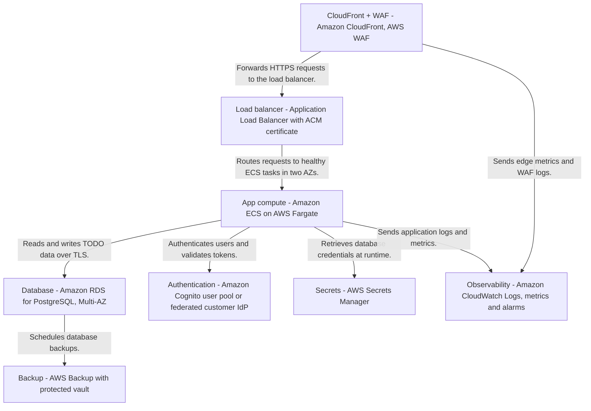

# XATA TODO Platform: Single-Region AWS Proposal

**Architecture draft for review**

Proposal: one Region across two AZs, containerized web and API behind CloudFront and ALB, Multi-AZ PostgreSQL, and managed authentication. Not load-tested, costed or validated against SLA.

## AWS architecture

## Components

### CloudFront + WAF — Amazon CloudFront, AWS WAF

HTTPS edge with managed rules against injection and XSS.

**Cost driver** — Request, data transfer and WAF rule volume.

### Load balancer — Application Load Balancer with ACM certificate

TLS termination and health-checked routing across AZs.

**Cost driver** — Hours plus LCU consumption.

### App compute — Amazon ECS on AWS Fargate

Horizontal scaling with no server patching; web and API as separate services.

**Cost driver** — vCPU and memory task-hours, minimum task count for two AZs.

### Database — Amazon RDS for PostgreSQL, Multi-AZ

Relational integrity between TODOs and users, plus automated backups with point-in-time recovery.

**Cost driver** — Instance class, standby instance, storage, backup storage.

### Authentication — Amazon Cognito user pool or federated customer IdP

Managed login avoids building local password hashing; customer IdP is an external boundary.

**Cost driver** — Monthly active users and any advanced security features.

### Secrets — AWS Secrets Manager

Holds database credentials and configuration outside code.

**Cost driver** — Per-secret and API call charges.

### Observability — Amazon CloudWatch Logs, metrics and alarms

Tracks request failures, latency and health; logs exclude sensitive data.

**Cost driver** — Log ingestion and retention, custom metrics, alarms.

### Backup — AWS Backup with protected vault

Scheduled database backups stored in a vault with restricted access.

**Cost driver** — Backup storage GB-months and restore operations.

## Design trade-offs

- **Choice** — RDS PostgreSQL Multi-AZ
  - **Alternative** — DynamoDB
  - **Trade-off** — Keeps referential integrity and simple filtering; large write scaling needs more design.
- **Choice** — ECS on Fargate
  - **Alternative** — EC2 Auto Scaling or Lambda
  - **Trade-off** — Low operations effort; per-task cost may exceed EC2 at sustained high utilization.
- **Choice** — Cognito or federated IdP for login
  - **Alternative** — Local passwords stored in the database
  - **Trade-off** — Avoids local hashing and credential risk; adds identity dependency and integration work.

## Security

- Enforce HTTPS/TLS at CloudFront and ALB (BA-0065).
- Enforce role and ownership checks server-side (BA-0063, BA-0064, BA-0032).
- Encrypt database and backups with KMS; restrict vault access (BA-0097).
- Use least-privilege IAM task roles; store no hard-coded secrets (BA-0066).
- Assumed: Team Leads may edit team members' TODOs; Administrators hold no TODO-level rights.

## Operations

- Use ALB and ECS health checks (BA-0092).
- Deploy with blue/green ECS releases through CI/CD.
- Alarm on 5xx rate, p95 latency against 2 s, task health and database storage/CPU.
- Document restore dependencies (BA-0110).
- Assumed: planned-maintenance notice goes to XATA IT by email, 24 h ahead.

## Failure and recovery

- AZ loss: ECS and ALB continue in the second AZ; RDS standby promotes. Failover duration is not guaranteed and must be measured.
- Task failure: ECS replaces tasks automatically; measure user impact.
- Data loss: point-in-time recovery must be validated against the 15-minute RPO.
- Full restore: validate the 30-minute RTO by timing a restore into a new instance.
- Measure failed requests and affected users during failover, not only instance state.

## Open decisions

- Agree the availability formula, maintenance exclusions and measurement period for 99.5%.
- Define when the 30-minute restoration clock starts and stops.
- Confirm whether RPO 15 min and RTO 30 min apply to major failures.
- Define normal load and the p95 measurement window; assumed 500 users and 100,000 records.
- Confirm team model: one team per user, maintained by Administrators (assumed).
- Confirm delete and reassign rules and who grants early due dates (assumed Team Leads and Administrators).
- Confirm whether Should-priority NFRs gate production acceptance (assumed non-gating).
- Provide the retention policy and the list of audited admin actions.
- Confirm the browser list (assumed current Chrome and Edge).
- Confirm Cognito versus customer IdP.

## Evidence inspected

- `XATA_TODO_NFR.docx-012` — Target RPO: 15 minutes unless XATA agrees otherwise.
- `XATA_TODO_NFR.docx-004` — ≥ 99.5%, excluding agreed maintenance windows
- `XATA_TODO_NFR.docx-006` — All users shall be authenticated before protected functionality.

## Requirements coverage

- **BA-0001 — requires_decision** — The platform shall allow XATA employees to create, manage, prioritize, track and complete personal and team TODO items.
  - The web app on ECS with RDS PostgreSQL supports create, manage, prioritize, track and complete for personal TODOs, but team TODO scope depends on the unconfirmed team model.
  - **Verify** — Confirm the team model with the customer, then test create, edit, prioritize and complete for both personal and team TODOs against that model.
  - **BA sources** — XATA_TODO_BRD.docx-002
- **BA-0002 — addressed** — The solution shall provide a single, centralized web application as the common place to manage TODO items.
  - A single centralized web application is served through CloudFront, WAF and ALB to ECS web tasks, with one data store in RDS PostgreSQL.
  - **Verify** — Confirm that all TODO functions are reachable from one application URL and that no alternate entry points are needed.
  - **BA sources** — XATA_TODO_BRD.docx-003, XATA_TODO_BRD.docx-004
- **BA-0003 — addressed** — Users shall be able to quickly create and update TODO items.
  - The web and API services use a simple request path and a p95 latency alarm at 2 s, which provides a design basis for quick create and update.
  - **Verify** — Measure p95 create and update latency under the agreed normal load, using a measurement window the customer has approved.
  - **BA sources** — XATA_TODO_BRD.docx-004
- **BA-0004 — addressed** — The solution shall provide visibility of open, completed and overdue TODO work.
  - Status and due-date fields stored in RDS allow the web app to query and show open, completed and overdue counts.
  - **Verify** — Seed test data with open, completed and overdue items and check that the dashboard counts match the database query results.
  - **BA sources** — XATA_TODO_BRD.docx-004
- **BA-0005 — requires_decision** — Team members shall be able to assign TODO items to one another.
  - Assignment is served by the API with server-side checks, but assignment and reassignment rules depend on the unconfirmed team model and reassign rules.
  - **Verify** — Confirm the team model and reassign rules, then test that assignment succeeds only for permitted roles and is denied otherwise.
  - **BA sources** — XATA_TODO_BRD.docx-004
- **BA-0006 — addressed** — The solution shall provide basic priority and due-date management for TODO items.
  - Priority and due-date fields are stored with each TODO in RDS and edited through the web app and API.
  - **Verify** — Create, edit and clear priority and due-date values and confirm they persist and display correctly after reload.
  - **BA sources** — XATA_TODO_BRD.docx-004
- **BA-0007 — addressed** — The solution shall provide a simple dashboard for work tracking.
  - A simple dashboard view is served by the web app and reads summary data from RDS.
  - **Verify** — Confirm the dashboard loads with representative data and shows the agreed work-tracking summaries.
  - **BA sources** — XATA_TODO_BRD.docx-004
- **BA-0008 — gap** — The first release shall be intentionally small and easy to use.
  - The draft has no design response for ease of use; the architecture describes scope but not usability measures.
  - **Verify** — Add a usability acceptance criterion with the customer, then validate it through user testing on the confirmed browser list.
  - **BA sources** — XATA_TODO_BRD.docx-003
- **BA-0009 — addressed** — The solution shall reduce dependency on spreadsheets, email and chat for TODO tracking.
  - A single centralized TODO application provides a system of record intended to replace spreadsheet, email and chat tracking.
  - **Verify** — After release, compare tracking activity in the platform against the baseline agreed with the customer; measure adoption rather than assuming it.
  - **BA sources** — XATA_TODO_BRD.docx-004
- **BR-001 — addressed** — System shall allow an authenticated user to create a TODO.
  - Cognito or the federated IdP authenticates the user, and the API writes new TODO records to RDS after token validation.
  - **Verify** — Test that an authenticated user can create a TODO and that an unauthenticated request is rejected.
  - **BA sources** — XATA_TODO_BRD.docx-008, XATA_TODO_BRD.docx-005
- **BR-002 — addressed** — A TODO shall contain title, description, status, priority and due date. Users shall be able to set priority and due date.
  - The RDS data model stores title, description, status, priority and due date for each TODO, with the web app and API allowing users to set priority and due date.
  - **Verify** — Create a TODO with all five fields and confirm each field is stored, validated and returned correctly by the API.
  - **BA sources** — XATA_TODO_BRD.docx-008, XATA_TODO_BRD.docx-005
- **BR-003 — requires_decision** — Users shall be able to edit TODOs they own or are authorized to manage.
  - Edit access is enforced server-side on the API, but the rules for who may edit items they are authorized to manage rest on assumed Team Leads and Administrator permissions that are not yet confirmed.
  - **Verify** — Confirm the authorization matrix with the customer, then test edits by owner, Team Lead, member and Administrator roles, including denied cases.
  - **BA sources** — XATA_TODO_BRD.docx-008, XATA_TODO_BRD.docx-005
- **BR-004 — addressed** — Users shall be able to mark TODOs as completed.
  - The ECS API updates TODO status to Completed in the RDS PostgreSQL table, with server-side ownership checks on each change.
  - **Verify** — Run API tests that mark a TODO Completed, confirm the change persists in RDS, and confirm a user without rights gets a denied response.
  - **BA sources** — XATA_TODO_BRD.docx-008, XATA_TODO_BRD.docx-005
- **BR-005 — requires_decision** — Users shall be able to assign a TODO to another authorized user.
  - The API can persist assignee changes in RDS, but 'authorized user' depends on the unconfirmed team model and reassign rules.
  - **Verify** — After the team model and reassign rules are agreed, test that assignment succeeds only for permitted users and is rejected for all others.
  - **BA sources** — XATA_TODO_BRD.docx-008, XATA_TODO_BRD.docx-005
- **BR-006 — addressed** — System shall support Open, In Progress and Completed statuses.
  - Status is stored as a constrained enumeration (Open, In Progress, Completed) in RDS and validated by the API.
  - **Verify** — Test that each of the three statuses can be set and that any other value is rejected by the API and the database constraint.
  - **BA sources** — XATA_TODO_BRD.docx-008
- **BR-007 — addressed** — System shall support Low, Medium, High and Critical priorities.
  - Priority is stored as a constrained enumeration (Low, Medium, High, Critical) in RDS and validated by the API.
  - **Verify** — Test that each of the four priorities can be set and that any other value is rejected by the API and the database constraint.
  - **BA sources** — XATA_TODO_BRD.docx-008
- **BR-008 — addressed** — Users shall filter TODOs by status, priority, assignee and due date.
  - The API applies status, priority, assignee and due-date filters as parameterized RDS queries, supported by indexes on those columns.
  - **Verify** — Run filter combinations against a dataset of 100,000 records (assumed volume) and measure p95 latency against the 2 s target.
  - **BA sources** — XATA_TODO_BRD.docx-008, XATA_TODO_BRD.docx-005
- **BR-009 — addressed** — Users shall search TODOs by title or description.
  - The API runs case-insensitive title and description searches as parameterized RDS queries; full-text indexing may be needed if plain pattern matching is too slow.
  - **Verify** — Benchmark search against 100,000 assumed records and confirm p95 stays within 2 s, adding indexing only if the benchmark fails.
  - **BA sources** — XATA_TODO_BRD.docx-008, XATA_TODO_BRD.docx-005
- **BA-0019 — requires_decision** — Support user login and a basic user profile.
  - Login uses Cognito or a federated customer IdP (external boundary), and the basic profile is stored in RDS, but the choice between the two is unconfirmed.
  - **Verify** — After the Cognito versus customer IdP decision, test sign-in, token validation and profile creation end to end.
  - **BA sources** — XATA_TODO_BRD.docx-005
- **BA-0020 — requires_decision** — Users shall be able to view and delete TODOs.
  - The API exposes view and delete endpoints for TODOs, but delete rules remain unconfirmed and the assumed rules (Team Leads and Administrators) are not agreed.
  - **Verify** — After delete rules are agreed, test that view and delete succeed for permitted roles and are denied for others.
  - **BA sources** — XATA_TODO_BRD.docx-005
- **BA-0021 — addressed** — TODOs shall support a description and optional notes.
  - RDS stores a description and optional notes as nullable text columns on the TODO record, and the API accepts both.
  - **Verify** — Create TODOs with and without notes and confirm both values round-trip correctly through the API and RDS.
  - **BA sources** — XATA_TODO_BRD.docx-005
- **BA-0022 — addressed** — Provide a dashboard showing TODO status.
  - The web service on ECS serves a dashboard that aggregates TODO counts by status from RDS for the signed-in user's visible records.
  - **Verify** — Compare dashboard counts with a direct RDS query for the same user and confirm they match after status changes.
  - **BA sources** — XATA_TODO_BRD.docx-005
- **BA-0023 — requires_decision** — Provide a basic team view for assigned TODOs.
  - A team view can be served from RDS team and assignment data, but the team model is only assumed and not confirmed.
  - **Verify** — After the team model is confirmed, test that the team view shows only assigned TODOs for team members and no others.
  - **BA sources** — XATA_TODO_BRD.docx-005
- **BA-0024 — addressed** — Maintain audit information such as created date and updated date for TODOs.
  - RDS stores created and updated timestamps on each TODO, set by the API on insert and update.
  - **Verify** — Create and update a TODO and confirm the created and updated timestamps are set correctly and the updated timestamp changes only on update.
  - **BA sources** — XATA_TODO_BRD.docx-005
- **BA-0025 — addressed** — Employee role: create and manage own TODOs, view assigned TODOs, and update status.
  - The ECS-hosted API enforces Employee permissions server-side using identity from Cognito or the federated IdP, with ownership checks limiting writes to the user's own TODOs.
  - **Verify** — Run role-based API tests as an Employee to confirm own-TODO create, update and status change succeed, assigned TODOs are readable, and other users' TODOs are rejected.
  - **BA sources** — XATA_TODO_BRD.docx-007
- **BA-0026 — requires_decision** — Team Lead role: create and assign TODOs, view team TODOs, and monitor overdue work.
  - Team Lead create, assign, team-view and overdue-monitoring behavior depends on the team model, which is assumed (one team per user, maintained by Administrators) but not confirmed.
  - **Verify** — Confirm the team membership model with the customer, then test Team Lead create, assign, team-view and overdue-view flows against that confirmed model.
  - **BA sources** — XATA_TODO_BRD.docx-007
- **BA-0027 — requires_decision** — Administrator role: manage users and basic platform configuration.
  - The draft covers Administrator user management only implicitly through the unconfirmed Cognito versus federated IdP choice, and 'basic platform configuration' is not scoped.
  - **Verify** — Confirm the Administrator feature list and the identity provider choice, then test that Administrator actions are limited to the confirmed scope.
  - **BA sources** — XATA_TODO_BRD.docx-007
- **BR-010 — gap** — Dashboard shall show Open, In Progress, Completed and Overdue counts. Priority: Must.
  - The draft has no dashboard aggregation design, including how Open, In Progress, Completed and Overdue counts are computed or what 'overdue' means.
  - **Verify** — Add a dashboard query design with a defined overdue rule, then verify counts against a seeded dataset with known statuses and due dates.
  - **BA sources** — XATA_TODO_BRD.docx-009
- **BR-011 — requires_decision** — Team Leads shall view TODOs assigned to their team members. Priority: Must.
  - Team Lead visibility of team members' TODOs depends on the unconfirmed team model and membership data.
  - **Verify** — After the team model is confirmed, test that a Team Lead sees only assigned TODOs for their team members and no TODOs from other teams.
  - **BA sources** — XATA_TODO_BRD.docx-009
- **BR-012 — addressed** — System shall maintain created-by, created-date, updated-by and updated-date for each TODO. Priority: Must.
  - The PostgreSQL TODO schema stores created-by, created-date, updated-by and updated-date, with the API setting them from the authenticated identity and server time.
  - **Verify** — Create and update TODOs through the API and confirm all four audit fields are populated correctly and cannot be overwritten by client input.
  - **BA sources** — XATA_TODO_BRD.docx-009
- **BR-013 — requires_decision** — Users shall be able to delete TODOs where permitted. Priority: Should.
  - Delete permissions are assumed but not confirmed, so the server-side rule cannot be finalized.
  - **Verify** — Confirm delete rules by role and ownership, then test that permitted users can delete and all others receive an authorization error.
  - **BA sources** — XATA_TODO_BRD.docx-009
- **BR-014 — addressed** — System shall prevent unauthorized modification of another user's TODO. Priority: Must.
  - Server-side role and ownership checks on every TODO write prevent modification of another user's TODO, independent of the web client.
  - **Verify** — Using two non-privileged test users, attempt direct API updates to the other user's TODO and confirm each request is rejected with no data change.
  - **BA sources** — XATA_TODO_BRD.docx-009
- **BR-015 — requires_decision** — System shall provide a web interface through supported browsers. Priority: Must.
  - The web interface is served through CloudFront and the ALB, but the supported browser list is assumed (current Chrome and Edge) and not confirmed.
  - **Verify** — Confirm the browser list with the customer, then run the core workflows in each listed browser version.
  - **BA sources** — XATA_TODO_BRD.docx-009
- **BA-0034 — addressed** — Create TODO: enter title; enter description; select priority; select due date; optionally assign to a user; save the TODO.
  - The web and API services accept title, description, priority, due date and optional assignee, then persist the TODO to RDS over TLS.
  - **Verify** — Create TODOs with and without an assignee through the UI and API, then confirm that each saved record matches the submitted fields and that invalid input is rejected.
  - **BA sources** — XATA_TODO_BRD.docx-010
- **BA-0035 — requires_decision** — Manage TODO: view details; edit information; change status; change priority or due date; reassign where authorized; delete where authorized.
  - Reassign and delete rights depend on unconfirmed rules, so the authorization model for these operations is not final.
  - **Verify** — Confirm reassign and delete rules, then test each permitted and forbidden role for view, edit, status, priority, due date, reassign and delete.
  - **BA sources** — XATA_TODO_BRD.docx-011
- **BA-0036 — gap** — Dashboard: show total open TODOs, in-progress TODOs, completed TODOs, overdue TODOs, and high/critical priority TODOs.
  - The draft does not define the dashboard metrics for total open, in-progress, completed, overdue, or high/critical priority TODOs, including how priority levels map to 'high' and 'critical'.
  - **Verify** — Add metric definitions and a priority scheme, then verify each dashboard count against a seeded dataset with known values.
  - **BA sources** — XATA_TODO_BRD.docx-012
- **BA-0037 — gap** — A TODO must have a title.
  - The draft cites RDS relational integrity but names no title-required rule at the API or schema layer.
  - **Verify** — Add a field-level validation rule for title and test that create and update requests with an empty or missing title are rejected.
  - **BA sources** — XATA_TODO_BRD.docx-013
- **BA-0038 — requires_decision** — A due date cannot be earlier than creation date unless explicitly permitted.
  - No due-date validation is specified, and the exception for earlier due dates ('explicitly permitted') and who grants it are unconfirmed.
  - **Verify** — Confirm the permitted-exception rule and who may grant it, then test that due dates earlier than creation are rejected unless the exception applies.
  - **BA sources** — XATA_TODO_BRD.docx-013
- **BA-0039 — gap** — Completed TODOs must have Completed status.
  - The draft does not define how the Completed status is stored, set or enforced.
  - **Verify** — Define the status model and test that a TODO marked complete always carries the Completed status and that no other path leaves it inconsistent.
  - **BA sources** — XATA_TODO_BRD.docx-013
- **BA-0040 — addressed** — Only authorized users can assign or modify TODOs.
  - Server-side role and ownership checks in the ECS API restrict assign and modify actions to authorized users, with the team-edit model still assumed.
  - **Verify** — Run authorization tests per role (user, Team Lead, Administrator) for assign and modify calls, and confirm the team model with the customer.
  - **BA sources** — XATA_TODO_BRD.docx-013
- **BA-0041 — gap** — Overdue means due date has passed and status is not Completed.
  - The overdue definition (due date passed and status not Completed) is not reflected in any design element or query.
  - **Verify** — Add test cases on boundary due dates and statuses, and verify the overdue flag or query matches the definition.
  - **BA sources** — XATA_TODO_BRD.docx-013
- **BA-0042 — requires_decision** — Deleting a TODO must not delete the user account or other TODOs.
  - Foreign-key and cascade behavior is not specified, and the delete and reassign rules remain unconfirmed.
  - **Verify** — Confirm delete and reassign rules, then test that deleting a TODO leaves the user account and other TODOs intact.
  - **BA sources** — XATA_TODO_BRD.docx-013
- **BA-0043 — addressed** — User can log in and create a TODO.
  - The login path runs through Cognito or the federated IdP to the ECS API, which writes new TODOs to RDS PostgreSQL over TLS.
  - **Verify** — Run an end-to-end test of login followed by TODO creation in a staging environment, and confirm the IdP choice is settled.
  - **BA sources** — XATA_TODO_BRD.docx-015
- **BA-0044 — addressed** — TODO can be assigned, updated and completed.
  - The API service reads and writes TODO data in RDS, which supports assign, update and complete operations, subject to the unconfirmed assignment rules.
  - **Verify** — Run end-to-end tests for assign, update and complete operations and confirm each persists correctly in RDS.
  - **BA sources** — XATA_TODO_BRD.docx-015
- **BA-0045 — gap** — Dashboard counts correctly reflect TODO state.
  - No dashboard count query or aggregation design is described, and the status model it depends on is undefined.
  - **Verify** — Define the dashboard count definitions and compare query results against a seeded data set with known states.
  - **BA sources** — XATA_TODO_BRD.docx-015
- **BA-0046 — addressed** — Users cannot modify TODOs outside their authorization.
  - Server-side ownership and role checks enforce modification limits in the API, backed by the authorization model cited in the security section.
  - **Verify** — Attempt cross-user and unauthorized-role modifications through the API and confirm each is denied with no data change.
  - **BA sources** — XATA_TODO_BRD.docx-015
- **BA-0047 — gap** — Filtering and search return correct results.
  - The draft mentions simple filtering in the RDS trade-off but has no search design, indexes or search semantics.
  - **Verify** — Define filter and search semantics, add indexes for the filtered fields, and test result correctness against a seeded data set.
  - **BA sources** — XATA_TODO_BRD.docx-015
- **BA-0048 — requires_decision** — Application meets agreed NFRs.
  - The NFRs are not agreed: the availability formula, load profile, p95 window and whether Should-priority NFRs gate acceptance remain open.
  - **Verify** — Agree the NFR list, measurement rules and acceptance gating with the customer, then run load and failover tests against those agreed targets.
  - **BA sources** — XATA_TODO_BRD.docx-015
- **BA-0049 — requires_decision** — XATA can complete the core TODO lifecycle without administrator assistance.
  - Web and API ECS services with RDS for PostgreSQL support the core TODO lifecycle in-app, but delete and reassign rules and early-due-date grants remain unconfirmed assumptions.
  - **Verify** — Confirm the delete, reassign and early-due-date rules, then run an end-to-end create, update, complete and delete test per role with no administrator intervention.
  - **BA sources** — XATA_TODO_BRD.docx-015
- **NFR-PERF-001 — requires_decision** — Normal page/API response time must be ≤ 2 seconds for 95% of requests under normal load.
  - CloudFront, ALB, ECS on Fargate and RDS are sized for normal page/API response, with a p95 latency alarm at 2 s, but the design is not load-tested and the normal load and p95 window are unagreed.
  - **Verify** — Agree the normal load profile and p95 measurement window, then load test and measure the p95 page/API response time against ≤ 2 seconds.
  - **BA sources** — XATA_TODO_NFR.docx-003
- **NFR-PERF-002 — requires_decision** — TODO create/update operations must complete in ≤ 2 seconds for 95% of requests.
  - Create/update requests traverse the same CloudFront, ALB, ECS and RDS path with a p95 latency alarm at 2 s, but the p95 measurement window is unagreed and the path is not load-tested.
  - **Verify** — Agree the measurement window, then measure p95 TODO create and update completion time under agreed load against ≤ 2 seconds.
  - **BA sources** — XATA_TODO_NFR.docx-003
- **NFR-PERF-003 — requires_decision** — Dashboard loading must complete in ≤ 3 seconds for 95% of requests.
  - Dashboard loading uses the same edge, compute and database path, but no dashboard-specific query or caching design is described and the measurement window is unagreed.
  - **Verify** — Agree the measurement window, then measure p95 dashboard load time under agreed load against ≤ 3 seconds and review dashboard query plans.
  - **BA sources** — XATA_TODO_NFR.docx-003
- **NFR-PERF-004 — requires_decision** — Search/filter response must be ≤ 2 seconds for 95% of requests.
  - Search and filter run as PostgreSQL queries through the same stack, but the draft does not describe indexing for filter fields and the measurement window is unagreed.
  - **Verify** — Define the indexed filter fields and measurement window, then run EXPLAIN plans and a p95 search/filter timing test against ≤ 2 seconds at 100,000 records.
  - **BA sources** — XATA_TODO_NFR.docx-003
- **NFR-PERF-005 — addressed** — The platform must support at least 500 concurrent active users.
  - ECS on Fargate scales task count horizontally behind the ALB across two AZs to serve the assumed 500 active users, though this is not load-tested and the concurrency definition needs agreement.
  - **Verify** — Load test at 500 concurrent active users, using the agreed definition of concurrency, and confirm error rate and latency stay within the NFR targets.
  - **BA sources** — XATA_TODO_NFR.docx-003
- **NFR-AVL-001 — requires_decision** — Monthly availability shall be ≥ 99.5%, excluding agreed maintenance windows.
  - Multi-AZ ALB, ECS and RDS reduce single-AZ impact, but no availability guarantee is made and the availability formula, maintenance exclusions and measurement period for 99.5% are unagreed.
  - **Verify** — Agree the availability formula, exclusions and monthly measurement period, then measure monthly availability excluding only agreed maintenance windows against ≥ 99.5%.
  - **BA sources** — XATA_TODO_NFR.docx-004
- **NFR-AVL-002 — requires_decision** — Planned maintenance shall be communicated at least 24 hours in advance.
  - An assumed email notice to XATA IT 24 hours ahead covers planned maintenance, but the end-user audience and notification channel are not confirmed.
  - **Verify** — Confirm the notice audience and channel, then verify that each planned maintenance notice is issued at least 24 hours before the window.
  - **BA sources** — XATA_TODO_NFR.docx-004
- **NFR-AVL-003 — requires_decision** — Service shall be restored within 30 minutes after an application failure.
  - ECS task replacement, ALB health checks and RDS Multi-AZ standby promotion support recovery, but the 30-minute restoration clock start and stop points and whether RTO applies to major failures are unconfirmed.
  - **Verify** — Agree the clock boundaries, then inject an application failure and time restoration of user-facing service against 30 minutes.
  - **BA sources** — XATA_TODO_NFR.docx-004
- **BA-0058 — addressed** — The solution shall support growth in users and TODO volume without major redesign.
  - Separate web and API ECS services scale horizontally, and RDS storage and instance class can grow without changing the application structure, with DynamoDB noted as the alternative if large write scaling is required.
  - **Verify** — Run a growth test at 2x the assumed users and records, and confirm that scaling changes are configuration-only and not a redesign.
  - **BA sources** — XATA_TODO_NFR.docx-005
- **BA-0059 — addressed** — The solution shall support at least 100,000 TODO records initially.
  - A single RDS for PostgreSQL instance with autoscaling storage and a storage alarm comfortably holds at least 100,000 TODO records.
  - **Verify** — Seed 100,000 TODO records and confirm storage, query latency and the storage alarm behave as expected.
  - **BA sources** — XATA_TODO_NFR.docx-005
- **BA-0060 — addressed** — Application services should be horizontally scalable where practical.
  - Stateless web and API services on ECS Fargate behind an ALB scale horizontally by adding tasks, with a minimum count across two AZs.
  - **Verify** — Run a scale-out and scale-in test by changing task count and confirm requests are distributed and no sessions are lost.
  - **BA sources** — XATA_TODO_NFR.docx-005
- **BA-0061 — addressed** — Database design shall support future growth beyond initial capacity.
  - RDS for PostgreSQL Multi-AZ provides storage scaling and instance-class changes as the initial growth path, though the growth target is not yet quantified.
  - **Verify** — Load-test against the assumed 500 users and 100,000 records, then confirm headroom against the agreed growth target and the storage and CPU alarms.
  - **BA sources** — XATA_TODO_NFR.docx-005
- **BA-0062 — addressed** — All users shall be authenticated before accessing protected functionality.
  - Cognito or a federated customer IdP authenticates users, and the API validates tokens before any protected function runs.
  - **Verify** — Send unauthenticated requests to web and API endpoints and confirm each is rejected or redirected to login, with no TODO data returned.
  - **BA sources** — XATA_TODO_NFR.docx-006
- **BA-0063 — addressed** — Authorization shall be role-based.
  - Role checks run server-side in the API, and the Team Lead and Administrator role model is assumed pending confirmation.
  - **Verify** — Run role-matrix tests for each role against each endpoint, and confirm the role model with the customer.
  - **BA sources** — XATA_TODO_NFR.docx-006
- **BA-0064 — requires_decision** — Users shall only access TODO data permitted by their role.
  - Server-side ownership and role checks are proposed, but the permitted-data matrix depends on the unconfirmed team model, the Team Lead edit rights, and the delete and reassign rules.
  - **Verify** — After the team model and delete and reassign rules are agreed, test cross-user and cross-team read and write attempts and confirm each is denied when not permitted.
  - **BA sources** — XATA_TODO_NFR.docx-006
- **BA-0065 — addressed** — Data shall be encrypted in transit using HTTPS/TLS.
  - HTTPS is enforced at CloudFront and the ALB uses an ACM certificate, and the database connection is over TLS.
  - **Verify** — Confirm HTTP redirects to HTTPS, that CloudFront-to-ALB origin traffic is HTTPS-only, that the ALB TLS policy is current, and that RDS rejects non-TLS connections.
  - **BA sources** — XATA_TODO_NFR.docx-006
- **BA-0066 — addressed** — Sensitive credentials shall not be hard-coded.
  - Database credentials and configuration are held in Secrets Manager and retrieved at runtime with least-privilege IAM task roles.
  - **Verify** — Run secret scanning in CI, review the task definitions and code for literal credentials, and confirm the task roles can read only their own secrets.
  - **BA sources** — XATA_TODO_NFR.docx-006
- **BA-0067 — addressed** — If passwords are locally managed, they shall use secure industry-standard hashing.
  - The design has no local password store, since Cognito or a federated IdP handles credentials, so the hashing condition is not triggered.
  - **Verify** — Confirm the schema has no password columns and that no local-password fallback is in scope, once the Cognito versus IdP decision is made.
  - **BA sources** — XATA_TODO_NFR.docx-006
- **BA-0068 — addressed** — The application shall protect against common web vulnerabilities, including injection, broken access control and XSS.
  - CloudFront with WAF managed rules covers injection and XSS at the edge, and server-side ownership checks cover broken access control; the draft does not yet state application-level parameterized queries or output encoding.
  - **Verify** — Run OWASP-style tests for injection, XSS and broken access control against the deployed stack, and confirm the code uses parameterized queries and output encoding.
  - **BA sources** — XATA_TODO_NFR.docx-006
- **BA-0069 — requires_decision** — Administrative actions should be auditable.
  - Application logs go to CloudWatch, but no audit trail design exists yet, and the list of audited admin actions and the retention policy are unresolved.
  - **Verify** — Once the audited action list and retention policy are provided, test that each listed admin action produces an audit record and that retention matches the policy.
  - **BA sources** — XATA_TODO_NFR.docx-006
- **BA-0070 — addressed** — TODO records shall have unique identifiers.
  - Relational PostgreSQL tables give each TODO a primary key constraint as a unique identifier.
  - **Verify** — Confirm the TODO table has a primary key, and test that a duplicate identifier insert is rejected.
  - **BA sources** — XATA_TODO_NFR.docx-007
- **BA-0071 — gap** — Required fields shall be validated server-side.
  - The draft describes WAF filtering but no server-side required-field validation in the API layer.
  - **Verify** — Add API contract tests that send missing and invalid required fields and confirm the server rejects them regardless of client-side checks.
  - **BA sources** — XATA_TODO_NFR.docx-007
- **BA-0072 — gap** — Updates shall not silently overwrite conflicting data.
  - The draft describes no concurrency control, such as versioning or optimistic locking, to prevent silent overwrites of conflicting updates.
  - **Verify** — Run concurrent update tests on the same TODO and confirm that a conflicting write is rejected or flagged rather than silently overwriting the other.
  - **BA sources** — XATA_TODO_NFR.docx-007
- **BA-0073 — gap** — Created and updated timestamps shall be stored consistently.
  - The draft names RDS PostgreSQL but does not define a UTC timestamp type, a create/update population rule, or a single writer for created and updated fields.
  - **Verify** — Review the schema for timestamptz created_at and updated_at columns with defined defaults and update triggers, and test that both are set consistently on create and update.
  - **BA sources** — XATA_TODO_NFR.docx-007
- **BA-0074 — addressed** — Referential integrity shall be maintained between TODOs and users.
  - Relational PostgreSQL on RDS is chosen to maintain referential integrity between TODOs and users, which can be enforced with foreign-key constraints.
  - **Verify** — Confirm foreign keys from TODOs to users exist in the schema and that an insert or update referencing a nonexistent user is rejected by the database.
  - **BA sources** — XATA_TODO_NFR.docx-007
- **BA-0075 — requires_decision** — Deleted data handling shall follow XATA's retention policy.
  - The draft says deleted data should follow XATA's retention policy, but the policy is not provided and the delete and retention rules remain open decisions.
  - **Verify** — Obtain XATA's written retention policy and verify that delete behaviour, backup expiry and AWS Backup retention settings match it.
  - **BA sources** — XATA_TODO_NFR.docx-007
- **BA-0076 — gap** — Core create/update/complete flow should require minimal steps.
  - The architecture contains no UI interaction design defining the minimal steps for create, update and complete flows.
  - **Verify** — Add a UI flow specification and measure the click or step count for each core flow in usability testing against the agreed target.
  - **BA sources** — XATA_TODO_NFR.docx-008
- **BA-0077 — gap** — UI shall be responsive for standard desktop and tablet screens.
  - The draft specifies a web tier served through CloudFront but does not define responsive layout or breakpoints for desktop and tablet screens.
  - **Verify** — Add responsive layout requirements and test the UI at standard desktop and tablet viewport sizes.
  - **BA sources** — XATA_TODO_NFR.docx-008
- **BA-0078 — gap** — Validation errors shall be understandable.
  - The draft has no validation error design, so there is no defined mechanism for clear, user-facing validation messages from the API or UI.
  - **Verify** — Define validation message content and display rules, then test representative invalid inputs for understandable messages.
  - **BA sources** — XATA_TODO_NFR.docx-008
- **BA-0079 — gap** — Status, priority and overdue items shall be visually distinguishable.
  - The draft does not define visual states for status, priority or overdue items.
  - **Verify** — Add a visual state specification for status, priority and overdue items, then review it against the UI with users or an accessibility check.
  - **BA sources** — XATA_TODO_NFR.docx-008
- **BA-0080 — gap** — Common actions shall be discoverable without technical knowledge.
  - The draft does not describe navigation or labelling that would make common actions discoverable without technical knowledge.
  - **Verify** — Run a task-based usability test with non-technical users to confirm that common actions can be found without guidance.
  - **BA sources** — XATA_TODO_NFR.docx-008
- **BA-0081 — gap** — Target WCAG 2.1 AA principles where practical.
  - The draft has no accessibility design or testing approach for WCAG 2.1 AA principles.
  - **Verify** — Define the WCAG 2.1 AA scope and run an automated and manual accessibility audit of the core workflows.
  - **BA sources** — XATA_TODO_NFR.docx-009
- **BA-0082 — gap** — Keyboard navigation should support core workflows.
  - The draft does not specify keyboard operation, focus order or focus visibility for core workflows.
  - **Verify** — Complete the core workflows using only the keyboard and confirm focus order and visibility at each step.
  - **BA sources** — XATA_TODO_NFR.docx-009
- **BA-0083 — gap** — Form controls should have meaningful labels.
  - The draft does not define accessible labels for form controls.
  - **Verify** — Inspect each form control with an accessibility tree tool to confirm it has a meaningful programmatic label.
  - **BA sources** — XATA_TODO_NFR.docx-009
- **BA-0084 — gap** — Text should have sufficient contrast and readable sizing.
  - The draft does not specify text contrast ratios or minimum font sizing.
  - **Verify** — Define contrast and font-size targets, then check rendered text against them with a contrast analyser on the main screens.
  - **BA sources** — XATA_TODO_NFR.docx-009
- **BA-0085 — gap** — Solution shall use modular, maintainable code.
  - The draft separates web and API into ECS services but does not define code structure, module boundaries, or maintainability standards.
  - **Verify** — Add a code-structure standard and a review gate (linting, module-boundary rules, or architecture tests) in CI/CD, then confirm it runs on every build.
  - **BA sources** — XATA_TODO_NFR.docx-010
- **BA-0086 — addressed** — Business logic shall be separated from presentation and persistence.
  - Presentation (web service) and business/persistence (API service) run as separate ECS services, with the database reachable only from the API tier.
  - **Verify** — Confirm via security group and IAM review that only the API tier can reach RDS, and add in-code layering checks or code review criteria for the business-logic layer.
  - **BA sources** — XATA_TODO_NFR.docx-010
- **BA-0087 — gap** — APIs and major components shall be documented.
  - The draft does not specify API documentation, component documentation, or a publication method.
  - **Verify** — Add a documentation deliverable (for example, an OpenAPI specification and component READMEs) and verify it is published and kept current as a release gate.
  - **BA sources** — XATA_TODO_NFR.docx-010
- **BA-0088 — gap** — Automated unit tests shall cover critical business logic.
  - The draft describes blue/green CI/CD but does not require automated unit tests or coverage of critical business logic.
  - **Verify** — Add a unit-test requirement with a defined critical-logic scope and a pipeline gate, then verify test coverage reports for each release.
  - **BA sources** — XATA_TODO_NFR.docx-010
- **BA-0089 — addressed** — Configuration shall be externalized from source code.
  - Secrets Manager holds database credentials and runtime configuration, keeping them out of source code and images.
  - **Verify** — Scan repositories and container images for hard-coded configuration and secrets, and confirm the application reads config only from Secrets Manager or environment injection at runtime.
  - **BA sources** — XATA_TODO_NFR.docx-010
- **BA-0090 — addressed** — Logging shall support troubleshooting without exposing sensitive information.
  - Application and edge logs go to CloudWatch Logs under a rule that excludes sensitive data.
  - **Verify** — Define a redaction standard and test log output with sample sensitive inputs (passwords, tokens, personal data) to confirm they do not appear in CloudWatch Logs.
  - **BA sources** — XATA_TODO_NFR.docx-010
- **BA-0091 — addressed** — Application errors shall be logged with sufficient troubleshooting context.
  - Application errors are sent to CloudWatch Logs, and the 5xx alarm provides error visibility, though the required context fields are not yet specified.
  - **Verify** — Define the required error fields (timestamp, service, version, error type, request ID, and similar) and trigger controlled faults to confirm the fields appear in logs.
  - **BA sources** — XATA_TODO_NFR.docx-011
- **BA-0092 — addressed** — Health checks shall be available.
  - ALB target health checks route traffic only to healthy tasks, and ECS health checks replace failed tasks automatically.
  - **Verify** — Simulate an unhealthy task and confirm ALB stops routing to it and ECS replaces it, recording the time to detect and replace.
  - **BA sources** — XATA_TODO_NFR.docx-011
- **BA-0093 — addressed** — Key metrics should include request failures and response latency.
  - CloudWatch metrics and alarms track 5xx rate and p95 latency against the 2 s target, along with task health and database CPU and storage.
  - **Verify** — Confirm the dashboards and alarms fire under synthetic load; the p95 measurement window remains an open decision that must be agreed.
  - **BA sources** — XATA_TODO_NFR.docx-011
- **BA-0094 — gap** — Logs should include correlation/request identifiers where appropriate.
  - The draft does not specify correlation or request identifiers propagated through edge, ALB, API, and database logs.
  - **Verify** — Add request ID generation at CloudFront or ALB, propagate it through the API and logs, and verify that a single request can be traced end to end in CloudWatch Logs.
  - **BA sources** — XATA_TODO_NFR.docx-011
- **BA-0095 — addressed** — Operational alerts should be configurable for service failures.
  - CloudWatch alarms for service failures (5xx, latency, task health, database) are configurable in thresholds and notification targets.
  - **Verify** — Trigger each alarm in a test environment and confirm the notification reaches the agreed recipients; the notification route still needs confirmation.
  - **BA sources** — XATA_TODO_NFR.docx-011
- **BA-0096 — requires_decision** — Production data shall be backed up according to an agreed schedule.
  - AWS Backup schedules database backups into a protected vault, alongside RDS point-in-time recovery, but the agreed backup schedule and retention policy are not yet confirmed.
  - **Verify** — Obtain the agreed backup schedule and retention policy from the customer, then verify the AWS Backup plan and the RDS retention setting match them and that restores succeed.
  - **BA sources** — XATA_TODO_NFR.docx-012
- **BA-0097 — addressed** — Backups shall be protected from unauthorized access.
  - AWS Backup writes database backups to a protected vault encrypted with KMS, with vault access restricted to backup administrators.
  - **Verify** — Review the vault resource policy and KMS key policy, and confirm with IAM Access Analyzer and a negative test that non-backup roles cannot read or delete recovery points.
  - **BA sources** — XATA_TODO_NFR.docx-012
- **BA-0098 — addressed** — Solution shall support restoration after major failure.
  - Restoration is supported through RDS point-in-time recovery and AWS Backup vault recovery points, with a documented restore into a new instance.
  - **Verify** — Run a timed full-restore drill from a recovery point after a simulated major failure and record the outcome against the restore procedure.
  - **BA sources** — XATA_TODO_NFR.docx-012
- **BA-0099 — requires_decision** — Target RPO: 15 minutes unless XATA agrees otherwise.
  - RDS point-in-time recovery is proposed to meet the 15-minute RPO, but the proposal does not confirm that RPO applies to major failures and no recovery-point timing is guaranteed.
  - **Verify** — Measure the latest restorable time against the 15-minute RPO in a test, after XATA confirms whether RPO covers major failures and how data loss is measured.
  - **BA sources** — XATA_TODO_NFR.docx-012
- **BA-0100 — requires_decision** — Target RTO: 30 minutes.
  - The 30-minute RTO is targeted by a timed restore into a new instance, but the start and stop points of the restoration clock are not yet defined.
  - **Verify** — Time a restore drill from the agreed start event to the agreed stop event, once XATA has defined the clock and confirmed whether RTO applies to major failures.
  - **BA sources** — XATA_TODO_NFR.docx-012
- **BA-0101 — requires_decision** — Support current versions of major enterprise browsers such as Chrome and Edge.
  - The browser list is assumed to be current Chrome and Edge but is unconfirmed, and the proposal has no browser test matrix.
  - **Verify** — Obtain XATA's approved browser list and run functional tests against the current stable Chrome and Edge releases.
  - **BA sources** — XATA_TODO_NFR.docx-013
- **BA-0102 — gap** — Avoid browser-specific functionality unless approved.
  - The proposal does not state a design constraint or approval gate that prevents browser-specific functionality.
  - **Verify** — Add a front-end standards rule and an approval checkpoint in the release process, then review the code for browser-specific APIs during code review.
  - **BA sources** — XATA_TODO_NFR.docx-013
- **BA-0103 — gap** — APIs should use documented, versionable interfaces.
  - The API is a separate ECS service, but the proposal does not define API documentation, versioning, or a contract format.
  - **Verify** — Require a published API contract with a version scheme and confirm it is published and checked in CI.
  - **BA sources** — XATA_TODO_NFR.docx-013
- **BA-0104 — gap** — Collect only data required for TODO management.
  - The proposal does not define a data-minimization design beyond excluding sensitive data from logs.
  - **Verify** — Review the data model and API payloads against the TODO management data list and confirm that no unneeded personal fields are stored or returned.
  - **BA sources** — XATA_TODO_NFR.docx-014
- **BA-0105 — requires_decision** — Access to personal/team information shall follow XATA authorization rules.
  - Server-side role and ownership checks are proposed, but the team model is assumed and delete, reassign, and early-due-date rules are unconfirmed.
  - **Verify** — Run authorization tests across the confirmed roles and team model, covering allowed and denied cases for each rule once XATA confirms them.
  - **BA sources** — XATA_TODO_NFR.docx-014
- **BA-0106 — addressed** — Sensitive information shall not be written to application logs.
  - Application logs are designed to exclude sensitive data, and log content is controlled through the CloudWatch logging configuration.
  - **Verify** — Inject test sensitive values into requests, then search CloudWatch Logs and WAF logs to confirm that none of those values appear.
  - **BA sources** — XATA_TODO_NFR.docx-014
- **BA-0107 — requires_decision** — Data retention and deletion shall follow XATA policy.
  - Deletion and retention are not designed because XATA has not yet provided the retention policy or list of audited admin actions.
  - **Verify** — Map each data class to the XATA retention policy once provided, then test deletion and retention expiry in a non-production environment.
  - **BA sources** — XATA_TODO_NFR.docx-014
- **BA-0108 — addressed** — Critical application/database components shall have documented recovery procedures.
  - Recovery procedures for ECS, ALB, and RDS are planned, including documenting restore dependencies and using health checks and failover behavior.
  - **Verify** — Review the runbook for each critical component and confirm through a tabletop exercise or drill that a responder can follow it.
  - **BA sources** — XATA_TODO_NFR.docx-015
- **BA-0109 — requires_decision** — Recovery procedures shall be tested periodically.
  - The draft describes one-time restore validation (PITR and a timed restore into a new instance) but does not set a recurring test cadence.
  - **Verify** — Agree the recovery-test frequency with the customer, then schedule and record restore tests with timed results and evidence.
  - **BA sources** — XATA_TODO_NFR.docx-015
- **BA-0110 — addressed** — XBS shall document dependencies required to restore the service.
  - The operations section commits to documenting restore dependencies, which the architecture identifies as RDS backups and PITR, the AWS Backup vault, KMS keys, Secrets Manager secrets, VPC networking, and IAM task roles.
  - **Verify** — Review the restore-dependency document against the component list and perform a restore drill that uses only the documented dependencies.
  - **BA sources** — XATA_TODO_NFR.docx-015
- **BA-0111 — requires_decision** — XBS shall demonstrate compliance with agreed NFRs through appropriate testing, evidence, configuration review and operational validation before production acceptance.
  - The draft states the solution is not load-tested, costed, or validated against SLA, and no acceptance gate or evidence package is defined, including whether Should-priority NFRs gate acceptance.
  - **Verify** — Agree acceptance criteria, evidence types (load test, configuration review, operational validation), and the gating status of Should NFRs before production sign-off.
  - **BA sources** — XATA_TODO_NFR.docx-016
- **BA-0112 — addressed** — Security NFR category has priority Must.
  - The security section covers HTTPS/TLS at CloudFront and ALB, server-side role and ownership checks, KMS encryption with restricted vault access, least-privilege IAM, and no hard-coded secrets.
  - **Verify** — Run security configuration review and tests for TLS enforcement, authorization on each endpoint, KMS encryption status, and IAM policy scope.
  - **BA sources** — XATA_TODO_NFR.docx-017
- **BA-0113 — requires_decision** — Performance NFR category has priority Must.
  - The draft sets a p95 latency alarm at 2 s and uses an assumed load of 500 users and 100,000 records, but these values and the measurement window are unconfirmed and no load test exists.
  - **Verify** — Confirm normal load and the p95 measurement window with the customer, then run a load test against that profile and compare results to the 2 s target.
  - **BA sources** — XATA_TODO_NFR.docx-017
- **BA-0114 — requires_decision** — Availability NFR category has priority Must.
  - Multi-AZ ALB, ECS, and RDS provide a redundant design, but the 99.5% availability formula, maintenance exclusions, and measurement period are not agreed and failover duration is unmeasured.
  - **Verify** — Agree the availability formula, exclusions, and period, then measure downtime and failed requests during injected AZ and task failures.
  - **BA sources** — XATA_TODO_NFR.docx-017
- **BA-0115 — addressed** — Data Integrity NFR category has priority Must.
  - The design uses relational PostgreSQL integrity constraints between users and TODOs, server-side ownership checks, and Multi-AZ RDS with encryption at rest.
  - **Verify** — Test referential integrity constraints and ownership enforcement with negative tests, and verify Multi-AZ replication and KMS encryption settings.
  - **BA sources** — XATA_TODO_NFR.docx-017
- **BA-0116 — addressed** — Backup & Recovery NFR category has priority Must.
  - The design provides RDS point-in-time recovery, scheduled AWS Backup to a protected vault, and a restore procedure with a 15-minute RPO and 30-minute RTO target.
  - **Verify** — Validate PITR against the 15-minute RPO and time a full restore against the 30-minute RTO, after the customer agrees the restoration clock start and stop points and whether targets apply to major failures.
  - **BA sources** — XATA_TODO_NFR.docx-017
- **BA-0117 — gap** — Usability NFR category has priority Must.
  - The draft contains no usability design (for example, navigation, error handling, or responsive layout); it lists only an assumed browser set.
  - **Verify** — Define usability acceptance criteria and add UX design and user testing to the proposal.
  - **BA sources** — XATA_TODO_NFR.docx-017
- **BA-0118 — addressed** — Maintainability NFR category has priority Must.
  - Separate ECS services for web and API and blue/green releases through CI/CD support independent, low-risk changes and maintenance.
  - **Verify** — Run a test release through the blue/green pipeline with a rollback and confirm each service deploys independently.
  - **BA sources** — XATA_TODO_NFR.docx-017
- **BA-0119 — gap** — Accessibility NFR category has priority Should.
  - The draft has no accessibility design or conformance target; the browser list is assumed and does not address accessibility.
  - **Verify** — Agree the accessibility standard and conformance level, then add design and audit steps to the proposal.
  - **BA sources** — XATA_TODO_NFR.docx-017
- **BA-0120 — requires_decision** — Advanced observability NFR category has priority Should.
  - CloudWatch logs, metrics, alarms, and WAF/edge metrics provide baseline observability, but the draft does not define 'advanced' observability, and distributed tracing is not included.
  - **Verify** — Define the advanced observability scope with the customer, then decide whether to add tracing and dashboards and verify them against that scope.
  - **BA sources** — XATA_TODO_NFR.docx-017
