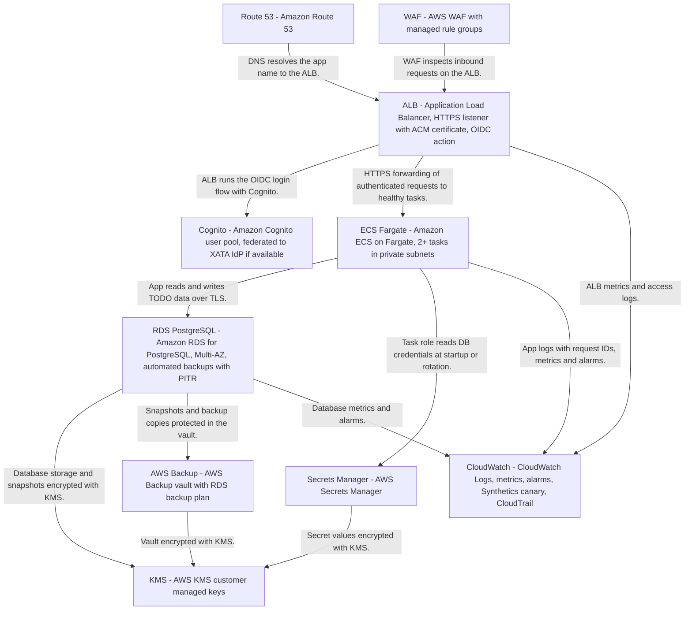

# XATA TODO Platform: single-Region AWS web app (proposal)

**Architecture draft for review**

Proposal: a Multi-AZ, single-Region web app on ECS Fargate behind an ALB with WAF, Cognito login, and RDS PostgreSQL. Simplest fit for 500 users and 100,000 TODOs. Targets are NFR values, not guaranteed compliance; several measurement rules still need XATA agreement.

## AWS architecture

## Components

### Route 53 — Amazon Route 53

Public DNS for the app hostname, pointing to the ALB.

**Cost driver** — Hosted zone and query volume.

### WAF — AWS WAF with managed rule groups

Filters common web attacks (injection, XSS) before requests reach the app. Supports BA-0068 but does not replace secure coding.

**Cost driver** — Web ACL, rule groups and request count.

### ALB — Application Load Balancer, HTTPS listener with ACM certificate, OIDC action

TLS termination across two AZs, health checks, and login enforcement before protected routes.

**Cost driver** — Hours and LCU usage.

### ECS Fargate — Amazon ECS on Fargate, 2+ tasks in private subnets

Stateless app serving the web UI and API. Horizontal scaling by task count, no servers to patch.

**Cost driver** — Always-on vCPU and memory for the minimum task count, plus scale-out.

### Cognito — Amazon Cognito user pool, federated to XATA IdP if available

Managed authentication so the app does not store passwords locally, avoiding hashing scope (BA-0067).

**Cost driver** — Monthly active users and any federation features used.

### RDS PostgreSQL — Amazon RDS for PostgreSQL, Multi-AZ, automated backups with PITR

Relational store with referential integrity between TODOs and users (BA-0074). Standby in second AZ for failover.

**Cost driver** — Instance class, Multi-AZ standby, storage and I/O.

### Secrets Manager — AWS Secrets Manager

Holds DB credentials so none are hard-coded (BA-0066).

**Cost driver** — Per-secret and API call charges.

### KMS — AWS KMS customer managed keys

Encryption at rest for RDS, backups and secrets.

**Cost driver** — Key count and API requests.

### AWS Backup — AWS Backup vault with RDS backup plan

Scheduled, centrally managed backups with retention and restricted access (BA-0097). Schedule is open.

**Cost driver** — Backup storage and retention length.

### CloudWatch — CloudWatch Logs, metrics, alarms, Synthetics canary, CloudTrail

Health and latency alarms, JSON logs with request IDs, a canary on the create/complete flow, and an audit trail for admin actions.

**Cost driver** — Log ingestion and retention, custom metrics, canary runs.

## Design trade-offs

- **Choice** — ECS Fargate in one Region across two AZs
  - **Alternative** — EKS or EC2 Auto Scaling, or Lambda with API Gateway
  - **Trade-off** — Less platform work than EKS or EC2, and a stateless container fits the workload. Lambda was not chosen because of cold starts and connection management with a relational database.
- **Choice** — RDS PostgreSQL Multi-AZ
  - **Alternative** — DynamoDB or Aurora Serverless
  - **Trade-off** — Relational constraints and simple reporting for a small dataset. Trade-off: vertical scaling limits and a failover window that must be measured, not assumed.
- **Choice** — Cognito federated login
  - **Alternative** — Local password store in the app
  - **Trade-off** — Avoids local password hashing and reset flows. Trade-off: dependency on the identity source and per-MAU cost; the IdP is unconfirmed.
- **Choice** — ALB OIDC authentication plus app-level role checks
  - **Alternative** — Token validation in each app route only
  - **Trade-off** — Login is enforced before any route is reached. Trade-off: authorization on each TODO must still be enforced in the app service layer.

## Security

- TLS 1.2+ at the ALB with an ACM certificate; TLS to RDS. Traffic in transit is covered by BA-0065.
- Tasks and RDS in private subnets. Security groups allow only ALB to tasks and tasks to RDS.
- Role-based checks enforced server-side for every read and write, including the assign and edit rules still under review.
- Secrets Manager with KMS for credentials. No secrets in code or images.
- CloudTrail logs administrative actions. Logs exclude sensitive fields (BA-0106).
- Proposal for BA-0014 and BA-0015: store TODO status as one of Open, In Progress, Completed and priority as one of Low, Medium, High, Critical, using a PostgreSQL enum type or CHECK constraint on the existing RDS PostgreSQL table. Also validate both fields server-side in the app service layer before any write. This adds no component and does not change the topology. Pending XATA review of the data model.

## Operations

- Health check endpoint on the ALB target group and ECS service health checks.
- Alarms on 5xx rate, p95 latency per NFR-PERF targets, task count, and RDS CPU, storage and failover events.
- Canary runs create, update and complete flows every few minutes to detect user-visible failure.
- Rolling ECS deployments. Planned maintenance is announced at least 24 hours in advance (NFR-AVL-002).
- Recovery runbook and dependency list kept with the solution (BA-0108, BA-0110).
- Proposed verification for BA-0014 and BA-0015: automated tests confirm that the three status values and four priority values are accepted at both the API and database layers. They also confirm that other values, including case variants, empty values and nulls, are rejected. Attach test results to the release evidence.

## Failure and recovery

- Task or AZ failure: ECS replaces tasks; ALB routes to the healthy AZ. Expected user impact is limited to in-flight requests (to be measured in test).
- DB primary failure: RDS Multi-AZ failover. Writes fail during failover; measure failed-request count and duration.
- Data corruption or error: point-in-time restore to a new instance. Target RPO 15 minutes and RTO 30 minutes apply only if XATA confirms scope and measurement.
- Region outage is not covered by this design. Cross-Region DR is an open decision.

## Open decisions

- Confirm RPO 15 min and RTO 30 min scope (data, components, service) and whether they are binding for acceptance.
- Define 'restored' and the start of the 30-minute clock.
- Define 'normal load', 'active user', the 95th percentile measurement window, and the calendar month and time zone for availability.
- Define which maintenance windows are agreed and excluded from the 99.5% target.
- Confirm the identity source and whether any passwords are locally managed.
- Confirm the edit, assign and delete authorization matrix and team membership.
- Set the backup schedule and retention, and the retention policy for deleted data.
- Decide whether a Region-level DR design is needed.
- Confirm whether status and priority value sets may change after launch, and if so, how existing rows are migrated. The value sets above follow BR-006 and BR-007 as written in the BRD and are not a customer-approved change process.

## Evidence inspected

- `XATA_TODO_NFR.docx-004` — ≥ 99.5%, excluding agreed maintenance windows
- `XATA_TODO_NFR.docx-003` — ≤ 2 seconds for 95% of requests
- `XATA_TODO_NFR.docx-012` — Target RPO: 15 minutes unless XATA agrees otherwise.
- `XATA_TODO_NFR.docx-006` — Authorization shall be role-based.

## Requirements coverage

- **BA-0001 — requires_decision** — The platform shall allow XATA employees to create, manage, prioritize, track and complete personal and team TODO items.
  - ECS Fargate app with RDS PostgreSQL and Cognito login supports create, manage, prioritize, track and complete for personal TODOs, but team scope depends on the unresolved team membership and authorization matrix.
  - **Verify** — Run end-to-end tests for personal create, update, prioritize, track and complete; confirm team-scope behavior only after XATA approves the team membership and authorization matrix.
  - **BA sources** — XATA_TODO_BRD.docx-002
- **BA-0002 — addressed** — XATA wants a simple centralized web application that provides a common place to manage TODOs, with the first release intentionally kept small and easy to use.
  - A single stateless web application on ECS Fargate behind an ALB provides one centralized, deliberately small TODO UI and API.
  - **Verify** — Review the first-release scope against the simple feature set and confirm with XATA that no extra modules are included.
  - **BA sources** — XATA_TODO_BRD.docx-003
- **BA-0003 — addressed** — The platform shall provide a single system for managing TODO items.
  - One Region, one web application and one RDS PostgreSQL database form a single system of record for TODO items.
  - **Verify** — Confirm in the deployment inventory that no second TODO store or parallel app exists in the first release.
  - **BA sources** — XATA_TODO_BRD.docx-004
- **BA-0004 — requires_decision** — The platform shall allow users to quickly create and update TODOs.
  - The app's create and update paths on ECS and RDS address the function, but 'quickly' has no agreed measurable target, and the NFR-PERF values and 95th percentile measurement window are unconfirmed.
  - **Verify** — Agree a measurable create and update latency target and measurement window with XATA, then load-test against it and check the p95 alarm in CloudWatch.
  - **BA sources** — XATA_TODO_BRD.docx-004
- **BA-0005 — addressed** — The platform shall provide visibility of open, completed and overdue work.
  - The app serves open, completed and overdue views by querying the RDS status and due-date fields, with no separate analytics store.
  - **Verify** — Seed test data with open, completed and past-due TODOs and confirm the view counts match the database queries.
  - **BA sources** — XATA_TODO_BRD.docx-004
- **BA-0006 — requires_decision** — The platform shall allow team members to assign TODOs to one another.
  - Assignment is not finalized because the assign rules and team membership are still under review, so the server-side authorization model for assignment is unresolved.
  - **Verify** — After XATA approves the assignment rules, test that only permitted users can assign and that unauthorized assignment attempts are rejected server-side.
  - **BA sources** — XATA_TODO_BRD.docx-004
- **BA-0007 — addressed** — The platform shall provide basic priority and due-date management for TODO items.
  - Priority and due-date fields are stored as relational columns in RDS and validated by the app service layer.
  - **Verify** — Test create and update with valid and invalid priority and due-date values and confirm database constraints and API validation reject invalid input.
  - **BA sources** — XATA_TODO_BRD.docx-004
- **BA-0008 — addressed** — The platform shall provide a simple dashboard for work tracking.
  - The ECS-hosted web UI provides a simple dashboard that reads work-tracking summaries from RDS.
  - **Verify** — Verify dashboard counts against known test data and confirm the Synthetics canary covers the dashboard load.
  - **BA sources** — XATA_TODO_BRD.docx-004
- **BR-001 — addressed** — System shall allow an authenticated user to create a TODO. (Priority: Must)
  - Authenticated users submit creates through the ALB (OIDC/Cognito) to ECS tasks, which write TODOs to RDS PostgreSQL over TLS.
  - **Verify** — Run an authenticated API test and a canary create flow, then confirm the new row in RDS and a 2xx response with a request ID in logs.
  - **BA sources** — XATA_TODO_BRD.docx-008
- **BR-002 — addressed** — A TODO shall contain title, description, status, priority and due date. (Priority: Must)
  - The RDS PostgreSQL TODO table is the designated store for title, description, status, priority and due date, with status and priority constrained as proposed; exact column types and nullability are not yet specified.
  - **Verify** — Review the approved data model against the five fields and run a schema test that creates a TODO with all five fields and reads them back unchanged.
  - **BA sources** — XATA_TODO_BRD.docx-008, XATA_TODO_BRD.docx-005
- **BR-003 — requires_decision** — Users shall be able to edit TODOs they own or are authorized to manage. (Priority: Must)
  - Server-side role checks in the app service layer will enforce edit rights on every write, but the owner and authorized-manager matrix and team membership are unconfirmed.
  - **Verify** — After XATA confirms the authorization matrix, run tests for owner, authorized manager and unauthorized user edits, expecting success, success and denial respectively.
  - **BA sources** — XATA_TODO_BRD.docx-008
- **BR-004 — addressed** — Users shall be able to mark TODOs as completed. (Priority: Must)
  - Marking a TODO completed is a permitted status update to Completed, validated server-side and stored in RDS, and the canary exercises the complete flow.
  - **Verify** — Run an API test that sets an authorized TODO to Completed and a canary run of the complete flow, then confirm the stored status and canary success.
  - **BA sources** — XATA_TODO_BRD.docx-008, XATA_TODO_BRD.docx-005
- **BR-005 — requires_decision** — Users shall be able to assign a TODO to another authorized user. (Priority: Must)
  - No assignee model is defined yet, and assignment rules are under review, so the design cannot yet enforce assignment to authorized users only.
  - **Verify** — After XATA defines assignment rules and team membership, test assignment to an authorized user (accepted) and to an unauthorized user (rejected) at both API and service layers.
  - **BA sources** — XATA_TODO_BRD.docx-008, XATA_TODO_BRD.docx-005
- **BR-006 — addressed** — System shall support Open, In Progress and Completed statuses. (Priority: Must)
  - Status is limited to Open, In Progress and Completed by a PostgreSQL enum or CHECK constraint plus server-side validation before any write, pending XATA data-model review.
  - **Verify** — Automated tests confirm the three values are accepted at API and database layers and that other values, case variants, empty values and nulls are rejected; attach results to release evidence.
  - **BA sources** — XATA_TODO_BRD.docx-008
- **BR-007 — addressed** — System shall support Low, Medium, High and Critical priorities. (Priority: Must)
  - Priority is limited to Low, Medium, High and Critical by a PostgreSQL enum or CHECK constraint plus server-side validation before any write, pending XATA data-model review.
  - **Verify** — Automated tests confirm the four values are accepted at API and database layers and that other values, case variants, empty values and nulls are rejected; attach results to release evidence.
  - **BA sources** — XATA_TODO_BRD.docx-008
- **BR-008 — requires_decision** — Users shall filter TODOs by status, priority, assignee and due date. (Priority: Must)
  - Filtering by status, priority and due date can be served by server-side queries on RDS, but filtering by assignee depends on the unresolved assignment model.
  - **Verify** — Test each filter combination against a 100,000-TODO dataset, and test the assignee filter once the assignment model is confirmed.
  - **BA sources** — XATA_TODO_BRD.docx-008, XATA_TODO_BRD.docx-005
- **BR-009 — gap** — Users shall search TODOs by title or description. (Priority: Should)
  - The draft names no search mechanism, index or query approach for title and description search, and no performance target for search.
  - **Verify** — Once a search approach is added to the design, test title and description matches on a 100,000-TODO dataset and measure latency against an agreed target.
  - **BA sources** — XATA_TODO_BRD.docx-008, XATA_TODO_BRD.docx-005
- **BA-0018 — requires_decision** — In scope: user login and basic user profile.
  - Login is handled by a Cognito user pool through the ALB OIDC flow, but the identity source is unconfirmed and the draft does not state where basic profile fields are stored.
  - **Verify** — Confirm the identity source and profile field storage (Cognito attributes or RDS), then test login and profile display for an authenticated user.
  - **BA sources** — XATA_TODO_BRD.docx-005
- **BA-0019 — requires_decision** — In scope: view and delete TODOs (create and edit are covered by BR-001 and BR-003).
  - View and delete run through the ECS app against RDS with server-side checks, but the delete authorization matrix and deleted-data retention policy are still open.
  - **Verify** — After XATA confirms the delete rules and retention policy, test that an unauthorized user cannot delete a TODO and that deletion behaves as the confirmed policy specifies.
  - **BA sources** — XATA_TODO_BRD.docx-005
- **BA-0020 — addressed** — In scope: add description and optional notes to a TODO.
  - Description and optional notes are stored as optional text fields in RDS PostgreSQL and written by the ECS app over TLS.
  - **Verify** — Test create and edit with and without notes, and confirm the stored values round-trip correctly; any length limits require XATA confirmation.
  - **BA sources** — XATA_TODO_BRD.docx-005
- **BA-0021 — addressed** — In scope: dashboard showing TODO status.
  - The ECS app serves a status dashboard by querying TODO status counts from RDS PostgreSQL.
  - **Verify** — Compare dashboard counts to a known test dataset and measure dashboard latency against the agreed p95 target.
  - **BA sources** — XATA_TODO_BRD.docx-005
- **BA-0022 — requires_decision** — In scope: basic team view for assigned TODOs.
  - A team view of assigned TODOs would be an app query on RDS, but team membership and the authorization matrix are unconfirmed.
  - **Verify** — After XATA defines team membership and the view rules, test that the team view shows only the TODOs a user is authorized to see.
  - **BA sources** — XATA_TODO_BRD.docx-005
- **BA-0023 — addressed** — In scope: audit information such as created date and updated date for TODOs.
  - Created and updated timestamps are stored as server-set columns in RDS PostgreSQL.
  - **Verify** — Create and update a TODO, then confirm created and updated timestamps are set by the server and updated on change.
  - **BA sources** — XATA_TODO_BRD.docx-005
- **BA-0024 — requires_decision** — Employee role responsibilities: create/manage own TODOs; view assigned TODOs; update status.
  - Employee create, manage-own, view-assigned and update-status actions would be enforced server-side in the ECS app, but the authorization matrix is still open.
  - **Verify** — After XATA confirms the authorization matrix, test each employee action and confirm that out-of-scope actions are denied.
  - **BA sources** — XATA_TODO_BRD.docx-007
- **BA-0025 — requires_decision** — Team Lead role responsibilities: create/assign TODOs; view team TODOs; monitor overdue work.
  - Team Lead create/assign and team view rely on server-side role checks, but the authorization matrix and team membership source are unconfirmed.
  - **Verify** — Confirm the Team Lead permission matrix and team membership source, then test allowed and denied create, assign, team-view and overdue-monitoring calls per role.
  - **BA sources** — XATA_TODO_BRD.docx-007
- **BA-0026 — gap** — Administrator role responsibilities: manage users and basic platform configuration.
  - The draft has no Administrator capability for user management or basic platform configuration; it mentions only CloudTrail logging of admin actions.
  - **Verify** — Define the admin functions and their hosting component, then test that only Administrator roles can perform user and configuration changes and that these actions appear in CloudTrail.
  - **BA sources** — XATA_TODO_BRD.docx-007
- **BR-010 — addressed** — Dashboard shall show Open, In Progress, Completed and Overdue counts. (Priority: Must)
  - The ECS app computes Open, In Progress, Completed and Overdue counts from TODO data in RDS and serves them through the web UI.
  - **Verify** — Seed known data including due-date edge cases and confirm each count matches expected values; the Overdue definition and time zone must be confirmed.
  - **BA sources** — XATA_TODO_BRD.docx-009
- **BR-011 — requires_decision** — Team Leads shall view TODOs assigned to their team members. (Priority: Must)
  - Team Lead visibility into team members' TODOs is enforced server-side, but team membership and the authorization matrix are unconfirmed.
  - **Verify** — After membership and matrix are confirmed, test that a Team Lead sees only assigned team members' TODOs and that out-of-team access returns denied.
  - **BA sources** — XATA_TODO_BRD.docx-009
- **BR-012 — addressed** — System shall maintain created-by, created-date, updated-by and updated-date. (Priority: Must)
  - The app writes created-by, created-date, updated-by and updated-date to RDS using the authenticated Cognito identity on each write.
  - **Verify** — Create and update TODOs as different users, then confirm the four audit fields are populated correctly and the updated fields change on edit.
  - **BA sources** — XATA_TODO_BRD.docx-009
- **BR-013 — requires_decision** — Users shall be able to delete TODOs where permitted. (Priority: Should)
  - Delete is enforced server-side by role checks, but the delete permission rules and retention policy for deleted data are still open.
  - **Verify** — Confirm delete permissions and deleted-data retention, then test permitted and forbidden delete attempts per role.
  - **BA sources** — XATA_TODO_BRD.docx-009
- **BR-014 — addressed** — System shall prevent unauthorized modification of another user's TODO. (Priority: Must)
  - Server-side role checks run on every read and write, with ALB OIDC login enforced before protected routes.
  - **Verify** — Run negative tests where user A attempts to read, edit or delete user B's TODO by ID and confirm each attempt is denied and logged.
  - **BA sources** — XATA_TODO_BRD.docx-009
- **BR-015 — addressed** — System shall provide a web interface through supported browsers. (Priority: Must)
  - The ECS app serves the web UI over HTTPS through the ALB with TLS 1.2+.
  - **Verify** — Test the UI in the browser versions XATA lists as supported; the supported browser list still needs confirmation.
  - **BA sources** — XATA_TODO_BRD.docx-009
- **BA-0033 — requires_decision** — Create TODO: user enters title and description, selects priority and due date, optionally assigns to a user, and saves the TODO.
  - The create flow writes title, description, priority, due date and optional assignee to RDS, but assignment behavior depends on unresolved assign rules.
  - **Verify** — Test create with and without assignee, confirming required and optional fields, and finalize assign rules before acceptance.
  - **BA sources** — XATA_TODO_BRD.docx-010
- **BA-0034 — requires_decision** — Manage TODO: user can view details, edit information, change status, change priority or due date, reassign where authorized, and delete where authorized.
  - Viewing, editing, status and priority changes are covered by server-side checks, while reassign and delete depend on the unresolved authorization matrix.
  - **Verify** — Confirm the edit, assign and delete matrix, then test each action per role, including reassign and delete denial cases.
  - **BA sources** — XATA_TODO_BRD.docx-011
- **BA-0035 — addressed** — Dashboard shall show a count of High/Critical priority TODOs.
  - The app counts High and Critical priority TODOs from RDS and displays the count on the dashboard.
  - **Verify** — Seed TODOs across all priority values and confirm the High/Critical count matches; the priority value set must be confirmed.
  - **BA sources** — XATA_TODO_BRD.docx-012
- **BA-0036 — addressed** — A TODO must have a title.
  - RDS relational constraints and app-level validation require a non-empty title before a TODO is saved.
  - **Verify** — Attempt to create and update TODOs with null, empty and whitespace-only titles and confirm each is rejected at both the API and database layers.
  - **BA sources** — XATA_TODO_BRD.docx-013
- **BA-0037 — gap** — A due date cannot be earlier than the creation date unless explicitly permitted.
  - The draft has no due-date validation in the app service layer or database constraints, so the rule that a due date cannot precede the creation date is not addressed.
  - **Verify** — Add a service-level test and a database constraint check that reject a due date earlier than the creation date, and confirm XATA defines whether any exception is permitted.
  - **BA sources** — XATA_TODO_BRD.docx-013
- **BA-0038 — gap** — Completed TODOs must have Completed status.
  - The draft defines no TODO status model or state-transition rule, so the requirement that completed TODOs must carry Completed status is not addressed.
  - **Verify** — Add a state model with the Completed status and a test that every completion action sets that status and that no other path leaves a completed TODO in another state.
  - **BA sources** — XATA_TODO_BRD.docx-013
- **BA-0039 — requires_decision** — Only authorized users can assign or modify TODOs, and users cannot modify TODOs outside their authorization.
  - The draft enforces role-based checks server-side on every read and write, but the assign and edit authorization matrix and team membership are still under review.
  - **Verify** — Obtain XATA's signed authorization matrix, then test that unauthorized users receive denial for assign and modify requests on TODOs outside their authorization.
  - **BA sources** — XATA_TODO_BRD.docx-013, XATA_TODO_BRD.docx-015
- **BA-0040 — gap** — Overdue means the due date has passed and the status is not Completed.
  - The draft does not define overdue status or any query, dashboard or filter logic that derives it from due date and status, so the requirement is not addressed.
  - **Verify** — Add a defined overdue query and test cases covering past due with open status, past due with Completed status, and future due dates.
  - **BA sources** — XATA_TODO_BRD.docx-013
- **BA-0041 — gap** — Deleting a TODO must not delete the user account or other TODOs.
  - The draft describes no delete scope or cascade behaviour, and referential integrity alone does not prove that deleting a TODO leaves the user account and other TODOs intact, so the requirement is not addressed.
  - **Verify** — Define the delete operation as single-row removal and add tests confirming the user account and other TODOs remain after a delete, pending XATA's decision on deleted-data retention.
  - **BA sources** — XATA_TODO_BRD.docx-013
- **BA-0042 — addressed** — The initial release is web-based.
  - The design delivers a browser-based web app through Route 53, an ALB HTTPS listener and ECS Fargate tasks, with no native client component.
  - **Verify** — Run end-to-end browser tests on the supported browsers and confirm no native client is in initial release scope.
  - **BA sources** — XATA_TODO_BRD.docx-014
- **BA-0043 — addressed** — The first release uses a single enterprise environment.
  - The draft describes one Region and one deployed stack with no separate environments, which fits a single enterprise environment.
  - **Verify** — Confirm with XATA that the release scope includes only this one deployed environment and that no additional environments are part of the initial release.
  - **BA sources** — XATA_TODO_BRD.docx-014
- **BA-0044 — addressed** — A user can log in and create a TODO.
  - Users sign in through the ALB OIDC flow with Cognito, and the ECS app handles the create TODO flow, which the Synthetics canary also exercises.
  - **Verify** — Run the create-TODO canary and a manual login-then-create test in the target environment and confirm each succeeds for an authorized user.
  - **BA sources** — XATA_TODO_BRD.docx-015
- **BA-0045 — requires_decision** — A TODO can be assigned, updated, and completed.
  - The app supports create, update and complete flows, but assignment rules are still under review, so the assign part of the requirement cannot be finalised.
  - **Verify** — After XATA approves the assignment rules, test assign, update and complete operations for each role against those rules.
  - **BA sources** — XATA_TODO_BRD.docx-015
- **BA-0046 — gap** — Dashboard counts correctly reflect TODO state.
  - The draft has no dashboard component or count logic, and the canary covers only create and complete flows, so dashboard count correctness is not addressed.
  - **Verify** — Add a dashboard component design and test that counts for open, completed and overdue TODOs match seeded data after each state change.
  - **BA sources** — XATA_TODO_BRD.docx-015
- **BA-0047 — gap** — Filtering and search return correct results.
  - The draft describes no search or filter design, index strategy or query behaviour, so correct filtering and search results are not addressed.
  - **Verify** — Define the filter and search behaviour and test representative queries against a seeded dataset of about 100,000 TODOs, comparing results to expected output.
  - **BA sources** — XATA_TODO_BRD.docx-015
- **BA-0048 — requires_decision** — The application meets the agreed NFRs.
  - The draft sets alarms and a canary against NFR-PERF and NFR-AVL targets, but XATA has not agreed the measurement rules, load definitions or exclusions needed to confirm compliance.
  - **Verify** — Agree the measurement rules with XATA, then run load, failover and availability tests and compare the measured results to the agreed targets.
  - **BA sources** — XATA_TODO_BRD.docx-015
- **BA-0049 — requires_decision** — XATA can complete the core TODO lifecycle without administrator assistance.
  - ECS-hosted create/update/complete flows behind ALB OIDC login support self-service use, but admin-free operation depends on the unconfirmed authorization matrix, team membership, and user onboarding rules.
  - **Verify** — Run a usability test where a user without admin rights completes create, update and complete flows end to end, after XATA confirms the authorization matrix and team membership model.
  - **BA sources** — XATA_TODO_BRD.docx-015
- **NFR-PERF-001 — requires_decision** — Normal page/API response time must be ≤ 2 seconds for 95% of requests under normal load.
  - Horizontal ECS scaling, RDS Multi-AZ, and p95 latency alarms address the 2-second target, but 'normal load' and the measurement window are not yet defined.
  - **Verify** — After XATA defines normal load and the p95 window, run a load test at that load and confirm p95 response time is ≤ 2 seconds for normal page and API requests.
  - **BA sources** — XATA_TODO_NFR.docx-003
- **NFR-PERF-002 — requires_decision** — TODO create/update operation must complete in ≤ 2 seconds for 95% of requests.
  - Create and update requests run through the same ECS and RDS path with p95 latency alarms and a canary on create/complete, but the p95 measurement window and the load profile for writes are not yet agreed.
  - **Verify** — Measure p95 create and update latency under the agreed load profile and confirm it is ≤ 2 seconds for 95% of requests over the agreed window.
  - **BA sources** — XATA_TODO_NFR.docx-003
- **NFR-PERF-003 — requires_decision** — Dashboard loading must complete in ≤ 3 seconds for 95% of requests.
  - Dashboard requests are served by the same ECS and RDS tiers, but no dashboard query design is described and the p95 measurement rules are not agreed.
  - **Verify** — Measure dashboard load p95 under the agreed load and confirm it is ≤ 3 seconds for 95% of requests, after XATA agrees the measurement rules.
  - **BA sources** — XATA_TODO_NFR.docx-003
- **NFR-PERF-004 — gap** — Search/filter response must be ≤ 2 seconds for 95% of requests.
  - The draft names RDS PostgreSQL as the data store but does not describe a search or filter design such as indexing, query shape, or pagination.
  - **Verify** — Add a search and filter design (indexes, query approach, pagination) and verify p95 search/filter response is ≤ 2 seconds for 95% of requests against a 100,000-record dataset.
  - **BA sources** — XATA_TODO_NFR.docx-003
- **NFR-PERF-005 — requires_decision** — The platform must support at least 500 concurrent active users.
  - ALB distribution across 2+ ECS tasks in two AZs provides a credible path to scale, but no task sizing, autoscaling policy, or definition of 'concurrent active user' is set.
  - **Verify** — After XATA defines concurrent active user, run a load test at 500 concurrent active users and confirm the platform sustains the agreed success and latency targets without manual intervention.
  - **BA sources** — XATA_TODO_NFR.docx-003
- **NFR-AVL-001 — requires_decision** — Monthly availability shall be ≥ 99.5%, excluding agreed maintenance windows.
  - Multi-AZ ALB, ECS, and RDS reduce single-AZ outage exposure, but the monthly availability calculation, agreed maintenance exclusions, calendar month, time zone, and failover measurement rules are not yet agreed.
  - **Verify** — Once XATA agrees the calendar month, time zone, and exclusions, compute monthly availability from logged outage minutes outside those exclusions and confirm it is ≥ 99.5%.
  - **BA sources** — XATA_TODO_NFR.docx-004
- **NFR-AVL-002 — addressed** — Planned maintenance shall be communicated at least 24 hours in advance.
  - The operations plan commits to announcing planned maintenance at least 24 hours in advance and uses rolling ECS deployments to limit planned downtime.
  - **Verify** — Review the maintenance announcement log for a sample of planned changes and confirm each notice was issued at least 24 hours before the window began.
  - **BA sources** — XATA_TODO_NFR.docx-004
- **NFR-AVL-003 — requires_decision** — After an application failure, service shall be restored within 30 minutes.
  - ECS task replacement and ALB health routing restore service after application failures, but 'restored' and the start of the 30-minute clock are undefined and the RTO applies only if XATA confirms scope.
  - **Verify** — Inject an application failure in a test environment, measure time from failure start to restored service using the agreed definition, and confirm it is within 30 minutes.
  - **BA sources** — XATA_TODO_NFR.docx-004
- **BA-0058 — addressed** — The solution shall support growth in users and TODO volume without major redesign.
  - Stateless ECS Fargate tasks scale out by count and RDS PostgreSQL can scale up by instance class, which is a credible path for growth; the growth ceiling and the point where DB vertical scaling would require redesign are not yet quantified.
  - **Verify** — Run a growth test at a user and TODO volume agreed with XATA and confirm scaling works by task count and instance class change without architecture changes.
  - **BA sources** — XATA_TODO_NFR.docx-005
- **BA-0059 — addressed** — The solution shall support at least 100,000 TODO records initially.
  - A single RDS PostgreSQL instance with storage sized for initial data supports 100,000 TODO records as a relational dataset of this size, with storage sizing to be confirmed.
  - **Verify** — Seed the database with 100,000 TODO records and confirm core list, create, update and search operations meet the agreed performance targets and storage remains within the provisioned capacity.
  - **BA sources** — XATA_TODO_NFR.docx-005
- **BA-0060 — addressed** — Application services should be horizontally scalable where practical.
  - Application services are stateless ECS Fargate tasks behind an ALB, so they can be scaled horizontally by task count.
  - **Verify** — Configure a scaling policy, then confirm under load test that task count increases and decreases while user sessions and requests succeed without sticky-session loss.
  - **BA sources** — XATA_TODO_NFR.docx-005
- **BA-0061 — requires_decision** — Database design shall support future growth beyond initial capacity.
  - RDS PostgreSQL can scale instance class and storage, but the draft states vertical scaling limits and sets no growth target or headroom, so the growth requirement cannot be sized.
  - **Verify** — Obtain a growth target from XATA, then load-test projected capacity and document the instance-class and storage scaling path and its downtime.
  - **BA sources** — XATA_TODO_NFR.docx-005
- **BA-0062 — addressed** — All users shall be authenticated before protected functionality is accessed.
  - The ALB OIDC action with Cognito enforces login before any protected route reaches the ECS tasks.
  - **Verify** — Send unauthenticated requests to every protected web and API path and confirm redirect or denial with no task-level access.
  - **BA sources** — XATA_TODO_NFR.docx-006
- **BA-0063 — requires_decision** — Authorization shall be role-based.
  - Role checks are enforced server-side in the app, but the role model and the edit, assign and delete authorization matrix are still open.
  - **Verify** — Document the agreed role-permission matrix and test each role against each read and write operation.
  - **BA sources** — XATA_TODO_NFR.docx-006
- **BA-0064 — requires_decision** — Users shall only access TODO data permitted by their role.
  - Server-side checks on every TODO read and write limit data access by role, but the permitted-access rules remain unconfirmed and ALB login alone does not restrict data.
  - **Verify** — After the matrix is agreed, run negative tests for cross-user and cross-role access to TODO records via the API and UI.
  - **BA sources** — XATA_TODO_NFR.docx-006
- **BA-0065 — addressed** — Data shall be encrypted in transit using HTTPS/TLS.
  - The ALB HTTPS listener uses an ACM certificate with TLS 1.2 or later, and the app connects to RDS over TLS.
  - **Verify** — Check the ALB listener security policy, require verified TLS on the RDS connection, and scan the endpoints to confirm that plaintext is refused.
  - **BA sources** — XATA_TODO_NFR.docx-006
- **BA-0066 — addressed** — Sensitive credentials shall not be hard-coded.
  - DB credentials are stored in Secrets Manager, encrypted with KMS, and read by the ECS task role, so no secrets are in code or images.
  - **Verify** — Run secret scanning on the repository and container images, and confirm the task role can read the secret while no plaintext credential appears in the task definition.
  - **BA sources** — XATA_TODO_NFR.docx-006
- **BA-0067 — requires_decision** — If passwords are locally managed, they shall use secure industry-standard hashing.
  - The draft avoids local password storage by using Cognito, but the identity source and whether any passwords are locally managed are unconfirmed, so hashing applicability is unresolved.
  - **Verify** — Confirm the identity source and whether any local passwords exist; if so, document the hashing standard and verify it through the identity provider configuration.
  - **BA sources** — XATA_TODO_NFR.docx-006
- **BA-0068 — requires_decision** — The application shall protect against common web vulnerabilities, including injection, broken access control and XSS.
  - WAF managed rule groups filter common injection and XSS attacks, and server-side checks cover access control, but the draft does not specify secure coding controls such as parameterized queries or output encoding, and the access matrix is open.
  - **Verify** — Run an OWASP-aligned scan and penetration test against injection, XSS and broken access control, and confirm that the WAF block logs show the managed rules are active.
  - **BA sources** — XATA_TODO_NFR.docx-006
- **BA-0069 — requires_decision** — Administrative actions should be auditable.
  - CloudTrail records AWS administrative actions, but the scope of application-level administrative actions is undefined and no app-level audit event design is described.
  - **Verify** — Define which admin actions must be audited, then confirm each one produces an audit record that includes the actor, time and target without sensitive fields.
  - **BA sources** — XATA_TODO_NFR.docx-006
- **BA-0070 — addressed** — TODO records shall have unique identifiers.
  - The relational PostgreSQL schema on RDS gives each TODO record a primary key constraint that uniquely identifies it.
  - **Verify** — Confirm the primary key definition in the schema and test that a duplicate identifier insert is rejected.
  - **BA sources** — XATA_TODO_NFR.docx-007
- **BA-0071 — gap** — Required fields shall be validated server-side.
  - The draft contains no server-side required-field validation design; WAF filtering does not replace it.
  - **Verify** — Add a server-side validation layer for required fields, then test that API requests with missing or invalid fields are rejected.
  - **BA sources** — XATA_TODO_NFR.docx-007
- **BA-0072 — gap** — Updates shall not silently overwrite conflicting data.
  - The draft has no optimistic locking, version field or conditional update design to prevent silent overwrites.
  - **Verify** — Add a concurrency control mechanism, then test two concurrent updates to one TODO and confirm that the conflict is reported rather than silently overwritten.
  - **BA sources** — XATA_TODO_NFR.docx-007
- **BA-0073 — gap** — Created and updated timestamps shall be stored consistently.
  - No design response: the draft names RDS PostgreSQL but does not specify timestamp types, a timezone convention, or how created and updated values are set.
  - **Verify** — Review the schema for created_at and updated_at as timestamptz set by the database or service, then test that an update changes updated_at and leaves created_at unchanged.
  - **BA sources** — XATA_TODO_NFR.docx-007
- **BA-0074 — addressed** — Referential integrity shall be maintained between TODOs and users.
  - RDS PostgreSQL is the relational store, and the draft specifies referential integrity between TODOs and users, which is enforced through foreign-key constraints.
  - **Verify** — Apply the schema in a test environment and confirm a foreign-key constraint rejects a TODO row that references a nonexistent user.
  - **BA sources** — XATA_TODO_NFR.docx-007
- **BA-0075 — requires_decision** — Deleted data handling shall follow XATA's retention policy.
  - Deleted-data handling depends on XATA's retention policy, which is an open decision, and the draft has no delete or purge design yet.
  - **Verify** — Obtain XATA's written retention and deletion policy, then confirm the delete behavior and AWS Backup retention match it before acceptance.
  - **BA sources** — XATA_TODO_NFR.docx-007
- **BA-0076 — gap** — Core create/update/complete flow should require minimal steps.
  - No design response: the draft does not define the create, update, or complete UI steps, and the canary checks only that the flow works, not that it is minimal.
  - **Verify** — Define the step count for each core flow in UX design and measure it in a usability test against the agreed target.
  - **BA sources** — XATA_TODO_NFR.docx-008
- **BA-0077 — gap** — UI shall be responsive for standard desktop and tablet screens.
  - No design response: the draft specifies no responsive layout or desktop and tablet breakpoint testing for the web UI.
  - **Verify** — Test core flows at agreed desktop and tablet viewport sizes in a browser matrix and record layout defects.
  - **BA sources** — XATA_TODO_NFR.docx-008
- **BA-0078 — gap** — Validation errors shall be understandable.
  - No design response: the draft does not specify how validation errors are worded, placed, or announced.
  - **Verify** — Trigger each validation rule on the create and update forms and review the error text with representative users.
  - **BA sources** — XATA_TODO_NFR.docx-008
- **BA-0079 — gap** — Status, priority and overdue items shall be visually distinguishable.
  - No design response: the draft does not specify visual treatment for status, priority, or overdue items.
  - **Verify** — Review the designs for non-color cues and check rendering with overdue and high-priority sample data.
  - **BA sources** — XATA_TODO_NFR.docx-008
- **BA-0080 — gap** — Common actions shall be discoverable without technical knowledge.
  - No design response: the draft does not specify how common actions are labeled, placed, or surfaced to first-time users.
  - **Verify** — Run first-use task testing with non-technical users and record the time and help requests needed to complete core actions.
  - **BA sources** — XATA_TODO_NFR.docx-008
- **BA-0081 — gap** — Target WCAG 2.1 AA principles where practical.
  - No design response: the draft names no WCAG 2.1 AA approach, audit, or exception process.
  - **Verify** — Run a WCAG 2.1 AA audit on core screens and record any exceptions with the reason each is impractical.
  - **BA sources** — XATA_TODO_NFR.docx-009
- **BA-0082 — gap** — Keyboard navigation should support core workflows.
  - No design response: the draft does not specify keyboard operation, focus order, or focus visibility for core workflows.
  - **Verify** — Complete create, update, and complete flows using only the keyboard and record any blocked or unclear steps.
  - **BA sources** — XATA_TODO_NFR.docx-009
- **BA-0083 — gap** — Form controls should have meaningful labels.
  - No design response: the draft does not specify labels for form controls.
  - **Verify** — Check every form control for an accessible name using automated scanning and a manual screen-reader pass.
  - **BA sources** — XATA_TODO_NFR.docx-009
- **BA-0084 — gap** — Text should have sufficient contrast and readable sizing.
  - No design response: the draft does not specify text contrast ratios or minimum text sizes.
  - **Verify** — Measure contrast ratios and rendered text sizes on core screens against the agreed standard.
  - **BA sources** — XATA_TODO_NFR.docx-009
- **BA-0085 — gap** — Solution shall use modular, maintainable code.
  - The draft describes infrastructure components but does not define code structure, module boundaries, or maintainability practices for the application.
  - **Verify** — Add an application code-structure standard (module layout, dependency rules) and review it in a code review against the repository before acceptance.
  - **BA sources** — XATA_TODO_NFR.docx-010
- **BA-0086 — gap** — Business logic shall be separated from presentation and persistence.
  - The draft mentions an application service layer only for authorization checks and does not define separation of business logic from presentation and persistence.
  - **Verify** — Document the layering (presentation, service, persistence) and confirm via static dependency analysis that UI and data-access code do not contain business rules.
  - **BA sources** — XATA_TODO_NFR.docx-010
- **BA-0087 — gap** — APIs and major components shall be documented.
  - The draft includes a recovery runbook and dependency list but no API documentation or documentation of major components.
  - **Verify** — Produce API specifications (for example OpenAPI) and component documentation, and check that they are published alongside the solution before acceptance.
  - **BA sources** — XATA_TODO_NFR.docx-010
- **BA-0088 — gap** — Automated unit tests shall cover critical business logic.
  - The draft contains no unit test strategy or coverage target for critical business logic.
  - **Verify** — Define the critical business logic set and a unit test suite with a coverage threshold, and run it in the CI pipeline before each deployment.
  - **BA sources** — XATA_TODO_NFR.docx-010
- **BA-0089 — gap** — Configuration shall be externalized from source code.
  - The draft externalizes database credentials to Secrets Manager but does not address externalization of non-secret configuration.
  - **Verify** — Specify where non-secret settings live (for example environment variables or Parameter Store) and confirm that no environment-specific values are in source code or container images.
  - **BA sources** — XATA_TODO_NFR.docx-010
- **BA-0090 — requires_decision** — Logging shall support troubleshooting without exposing sensitive information.
  - The draft proposes JSON logs with request IDs and excludes sensitive fields from CloudTrail, but app-log redaction rules are not defined because XATA has not classified sensitive data.
  - **Verify** — Obtain XATA's sensitive-field list, implement redaction in the app logger, and test by sending sample sensitive values and confirming they do not appear in CloudWatch Logs.
  - **BA sources** — XATA_TODO_NFR.docx-010
- **BA-0091 — addressed** — Application errors shall be logged with sufficient troubleshooting context.
  - Application errors are written as JSON to CloudWatch Logs with request IDs, which provides troubleshooting context.
  - **Verify** — Trigger controlled application errors in a test environment and confirm each log entry includes the request ID, error type, and route without sensitive fields.
  - **BA sources** — XATA_TODO_NFR.docx-011
- **BA-0092 — addressed** — Health checks shall be available.
  - The ALB target group health check and ECS service health checks provide a health endpoint for the application.
  - **Verify** — Mark a task unhealthy in a test environment and confirm ECS replaces it and the ALB stops routing to it.
  - **BA sources** — XATA_TODO_NFR.docx-011
- **BA-0093 — addressed** — Key metrics should include request failures and response latency.
  - CloudWatch covers ALB 5xx rate, p95 latency, task count, and RDS metrics with alarms, which captures request failures and response latency.
  - **Verify** — Generate synthetic errors and latency in a test environment and confirm the corresponding CloudWatch metrics and alarms change state as expected.
  - **BA sources** — XATA_TODO_NFR.docx-011
- **BA-0094 — addressed** — Logs should include correlation/request identifiers where appropriate.
  - JSON application logs carry request IDs, and ALB access logs are collected, which allows correlation across the request path.
  - **Verify** — Send a test request and confirm the same request ID appears in the ALB access log and the application log.
  - **BA sources** — XATA_TODO_NFR.docx-011
- **BA-0095 — addressed** — Operational alerts should be configurable for service failures.
  - CloudWatch alarms are configured for 5xx rate, latency, task count, and RDS events, giving configurable alerts for service failures.
  - **Verify** — Trigger each alarm condition in a test environment and confirm the notification is delivered to the configured destination.
  - **BA sources** — XATA_TODO_NFR.docx-011
- **BA-0096 — requires_decision** — Production data shall be backed up according to an agreed schedule.
  - AWS Backup with an RDS backup plan and vault is proposed, but the backup schedule and retention are not yet agreed by XATA.
  - **Verify** — Obtain XATA's agreed backup schedule and retention, configure the AWS Backup plan to match, and confirm a scheduled backup job completes successfully.
  - **BA sources** — XATA_TODO_NFR.docx-012
- **BA-0097 — addressed** — Backups shall be protected from unauthorized access.
  - Backups are held in an AWS Backup vault encrypted with a customer managed KMS key and restricted by vault access controls, with RDS snapshots and backup copies protected in that vault.
  - **Verify** — Review the vault access policy and KMS key policy, confirm that a non-authorized principal is denied vault and snapshot access, and confirm backup copies are encrypted with the customer managed key.
  - **BA sources** — XATA_TODO_NFR.docx-012
- **BA-0098 — addressed** — Solution shall support restoration after major failure.
  - Restoration is supported through RDS point-in-time restore to a new instance, Multi-AZ failover for instance failure, and a recovery runbook.
  - **Verify** — Run a timed point-in-time restore drill in a non-production account, then validate the restored data and reconnect a test ECS service to it.
  - **BA sources** — XATA_TODO_NFR.docx-012
- **BA-0099 — requires_decision** — Target RPO is 15 minutes unless XATA agrees otherwise.
  - RDS point-in-time recovery is the proposed mechanism, but the 15-minute RPO scope (data, components, service) and whether it is binding for acceptance are still unconfirmed.
  - **Verify** — Obtain XATA's written confirmation of RPO scope and binding status, then measure the actual data-loss window in a restore test against that agreed scope.
  - **BA sources** — XATA_TODO_NFR.docx-012
- **BA-0100 — requires_decision** — Target RTO is 30 minutes.
  - Restore-to-new-instance is proposed for recovery, but the 30-minute RTO scope and the definition of 'restored' and the start of the clock are still open.
  - **Verify** — Agree the RTO definition and clock start with XATA, then time a full restore-and-reconnect drill and compare the result to the agreed target.
  - **BA sources** — XATA_TODO_NFR.docx-012
- **BA-0101 — gap** — Solution shall support current versions of major enterprise browsers such as Chrome and Edge.
  - The draft has no browser support matrix or client-side test plan covering current Chrome and Edge.
  - **Verify** — Add a browser support statement and run the create, update and complete flows in current Chrome and Edge as part of acceptance testing.
  - **BA sources** — XATA_TODO_NFR.docx-013
- **BA-0102 — gap** — Browser-specific functionality shall be avoided unless approved.
  - The draft has no control or review step that restricts browser-specific features unless they are approved.
  - **Verify** — Add a front-end standards check or review gate that flags browser-specific APIs and requires approval before merge.
  - **BA sources** — XATA_TODO_NFR.docx-013
- **BA-0103 — gap** — APIs should use documented, versionable interfaces.
  - The draft does not define an API contract, documentation, or versioning scheme for the app's API.
  - **Verify** — Require a versioned API specification (for example OpenAPI) and confirm that version changes are reviewed before release.
  - **BA sources** — XATA_TODO_NFR.docx-013
- **BA-0104 — gap** — Solution shall collect only data required for TODO management.
  - The draft does not include a data inventory or minimization rule limiting collected data to TODO management needs, including Cognito user attributes.
  - **Verify** — Document the data inventory, confirm each stored field against TODO requirements, and review Cognito attribute configuration to remove unneeded attributes.
  - **BA sources** — XATA_TODO_NFR.docx-014
- **BA-0105 — requires_decision** — Access to personal/team information shall follow XATA authorization rules.
  - Server-side role checks are proposed for every read and write, but the edit, assign and delete authorization matrix and team membership rules are still unconfirmed.
  - **Verify** — Obtain the approved authorization matrix from XATA, then run authorization tests for each role and each TODO operation, including denied cases.
  - **BA sources** — XATA_TODO_NFR.docx-014
- **BA-0106 — gap** — Sensitive information shall not be written to application logs.
  - The draft says CloudTrail excludes sensitive fields, but CloudTrail does not cover application logs, and no field allowlist or redaction rule is defined for app JSON logs.
  - **Verify** — Define an application log field allowlist with redaction, then scan sample log output and CloudWatch Logs for test sensitive values and confirm none appear.
  - **BA sources** — XATA_TODO_NFR.docx-014
- **BA-0107 — requires_decision** — Data retention and deletion shall follow XATA policy.
  - Backup retention and the deleted-data retention policy are open, so the design cannot yet implement deletion rules that follow XATA policy.
  - **Verify** — Obtain the XATA retention and deletion policy, then configure AWS Backup retention and any application deletion behavior to match it and test that expired data is removed.
  - **BA sources** — XATA_TODO_NFR.docx-014
- **BA-0108 — addressed** — Critical application/database components shall have documented recovery procedures.
  - A recovery runbook and dependency list are planned for the solution, covering the ALB, ECS, RDS and backup components.
  - **Verify** — Review the runbook and dependency list with XATA operations and walk through the RDS restore and ECS recovery steps in a tabletop exercise.
  - **BA sources** — XATA_TODO_NFR.docx-015
- **BA-0109 — gap** — Recovery procedures shall be tested periodically.
  - The draft keeps a recovery runbook but defines no periodic schedule for testing restores or Multi-AZ failover.
  - **Verify** — Define a test cadence, run a PITR restore and an RDS failover test on that cadence, and record results with measured duration and failed-request count.
  - **BA sources** — XATA_TODO_NFR.docx-015
- **BA-0110 — addressed** — XBS shall document dependencies required to restore the service.
  - The draft keeps a dependency list with the solution and the recovery runbook, which covers the restore path.
  - **Verify** — Review the dependency list against a live restore test, confirming it includes Secrets Manager, KMS, AWS Backup, Cognito, Route 53, ACM and the ECS and RDS configuration.
  - **BA sources** — XATA_TODO_NFR.docx-015
- **BA-0111 — requires_decision** — XBS shall demonstrate compliance with agreed NFRs through appropriate testing, evidence, configuration review and operational validation before production acceptance.
  - The draft names canary, alarms and test-measured failure impacts, but acceptance evidence depends on measurement rules XATA has not yet agreed.
  - **Verify** — Agree measurement rules and acceptance criteria per NFR, then collect load, failover, restore, configuration review and operational validation evidence before production sign-off.
  - **BA sources** — XATA_TODO_NFR.docx-016
- **BA-0112 — addressed** — The Security NFR category has priority Must.
  - The draft applies TLS 1.2+, private subnets with scoped security groups, server-side role checks, Secrets Manager with KMS, and CloudTrail for admin actions.
  - **Verify** — Run a security review of each listed control and a penetration test, while noting that the edit, assign and delete authorization matrix remains open.
  - **BA sources** — XATA_TODO_NFR.docx-017
- **BA-0113 — requires_decision** — The Performance NFR category has priority Must.
  - The draft sets p95 latency alarms against NFR-PERF targets and scales by task count, but 'normal load', 'active user' and the p95 window are undefined.
  - **Verify** — Agree those definitions, then run a load test at normal load and confirm p95 latency over the agreed window meets the target.
  - **BA sources** — XATA_TODO_NFR.docx-017
- **BA-0114 — requires_decision** — The Availability NFR category has priority Must.
  - Multi-AZ ECS and RDS, rolling deployments and 24-hour maintenance notice support the 99.5% target, but the calendar month, time zone and excluded maintenance windows are unagreed and no compliance is guaranteed.
  - **Verify** — Agree the measurement rules and exclusions, then measure monthly availability excluding only the agreed exclusions and report failover impact from test.
  - **BA sources** — XATA_TODO_NFR.docx-017
- **BA-0115 — addressed** — The Data Integrity NFR category has priority Must.
  - RDS PostgreSQL enforces referential integrity, data is encrypted with KMS and PITR is enabled, and writes are authorized server-side.
  - **Verify** — Run schema constraint tests and a PITR restore check that compares restored records against known-good data sets.
  - **BA sources** — XATA_TODO_NFR.docx-017
- **BA-0116 — requires_decision** — The Backup & Recovery NFR category has priority Must.
  - AWS Backup with a vault and PITR provides the mechanism, but the backup schedule, retention, deleted-data policy and RPO/RTO scope are not yet set.
  - **Verify** — Confirm the schedule, retention and RPO/RTO scope with XATA, then test a restore against those targets and record the measured results.
  - **BA sources** — XATA_TODO_NFR.docx-017
- **BA-0117 — gap** — The Usability NFR category has priority Must.
  - The draft includes no usability design beyond a canary on the create and complete flow.
  - **Verify** — Define usability criteria with XATA and validate them through user testing or task-completion measurement before acceptance.
  - **BA sources** — XATA_TODO_NFR.docx-017
- **BA-0118 — addressed** — The Maintainability NFR category has priority Must.
  - Fargate removes host patching, rolling ECS deployments, a maintained runbook and structured JSON logs with request IDs support maintainability.
  - **Verify** — Review the maintainability criteria against deployment and runbook evidence, noting that the NFR detail was not in the supplied chunks and must be checked.
  - **BA sources** — XATA_TODO_NFR.docx-017
- **BA-0119 — gap** — The Accessibility NFR category has priority Should.
  - The draft includes no accessibility design or testing approach.
  - **Verify** — Define accessibility criteria with XATA and test the UI against them, such as with an automated scan and manual assistive-technology review.
  - **BA sources** — XATA_TODO_NFR.docx-017
- **BA-0120 — addressed** — The Advanced observability NFR category has priority Should.
  - CloudWatch logs, metrics and alarms, JSON logs with request IDs, a Synthetics canary and CloudTrail give advanced observability across ALB, ECS and RDS.
  - **Verify** — Trigger test failures and confirm that alarms fire and that logs can be correlated by request ID across ALB, app and database.
  - **BA sources** — XATA_TODO_NFR.docx-017
